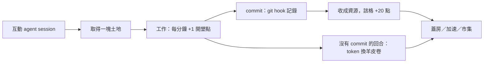

# herdr-reclaim

herdr 的一個 mod：**每個 agent session 都是一支遠征隊，工作時開墾土地，每次 commit 自動收成資源，再用資源蓋房。整座城就是你的工作史。**

目標只有一個：讓 herdr 的畫面變得好玩。它不是生產力追蹤工具，也不評斷你的程式碼好不好；畫面上的數字是遊戲數字，不是績效。

> 狀態：MVP 開發中。目前只支援 OMP（`omp`）的 session；Codex、Claude Code 的 adapter 在 v1.1。

## 它怎麼運作



- **一座城 = 一個 git repo。** 同一個 repo 的多個 space、worktree 共用一座城。非 git 資料夾不建城。
- **一塊土地 = 一個互動的 root session。** 新的 session（`/new`）取得另一格；`/resume` 回到原本那一格；child（subagent）算在它的 root 底下。
- **資源只來自 commit。** 沒有 commit 的工作不會憑空產出木材、石材、鐵料。

## 安裝

需要 herdr 與 `bun`，以及 `herdr-app` 指令。

```sh
sh tools/install.sh
```

這個腳本會把 mod 複製到 `~/.config/herdr-app/mods/herdr-reclaim`，把 OMP extension 複製到 `~/.omp/agent/extensions/`，並跑一次 `herdr-app check`。新開的 OMP session 才會載入 extension。

**收成需要 git hook。** 第一次看到一座還沒開啟的城時，畫面會問你要不要開啟自動收成（會在該 repo 的 `.git/hooks` 加三個小檔案）。沒開的城不會收成，只有工作時間。隨時可以從頂欄停止。詳見「git hook」一節。

## 地圖

- 城鎮中心是 2×2 共四格，不屬於任何遠征。
- 中心周圍一圈 12 格（含斜角）一開始就是已揭開的空地：看得到地面，但還沒人開墾。
- 新遠征從中心「相接」的 8 格（只算上下左右，斜角不算）開始，找最近的空格，距離相同時依北、東、南、西。
- 一格達到 100 點（已開墾）時，它自己和上下左右 4 格會揭開。
- 還沒開墾的遠征可以落在迷霧裡，不揭開任何鄰格。

## 土地的狀態

| 維度 | 值 | 說明 |
|---|---|---|
| 土地階段 | 未開墾 → 已開墾 → 已建；另有已撤回、已封存 | 只往前走。總點數達 100 自動變成已開墾 |
| 活動 | 探索中／駐紮 | root 或它的 child 只要有一個正在工作，就是探索中 |
| 來源 | 正常／來源不明 | 由 commit 證據重新計算，不需要你處理 |

**開墾點** = `工作分鐘數 + 收成點數 + 加速點數`

- 工作時間：每分鐘 1 點。root 與 child 同時工作時取聯集，不會重複算。
- 收成：每次有新單位的 commit，+20 點。
- 加速：每張羊皮卷 +10 點。

**撤回與封存** 只能用在「從未收成過任何資源」的土地：

- 撤回：未開墾的格子，釋放座標。
- 封存：已開墾、還沒蓋房的格子，座標保留但不再分配，地圖上不顯示。
- 已撤回或已封存的格子可以「重新派遣」：開新的一代（generation），重新選地，點數從 0 起算。有 commit 收成過的格子，按鈕不會出現。

## 收成：commit 怎麼變成資源

### 歸屬：這個 commit 是誰的？

hook 在 commit 發生時記下環境變數，用來判斷來源：

| 證據 | 結果 |
|---|---|
| `PI_SESSION_ID`（OMP 的 bash 會注入） | 歸到這個 session；若是 child，往上歸到 root |
| 只有 terminal ID，或什麼都沒有（IDE、手動 commit） | **不收成**，只留下紀錄與原因 |
| 沒有安裝 hook 的城 | 不收成 |
| 那個 session 當時所屬的那一代已撤回或封存 | 不收成 |

不提供人工補領，也不會猜測。來源不明的 commit 不影響你的程式碼，只是不發遊戲資源。如果之後取得能核對的證據，系統會自動重新判定，不用你操作。

OMP 在你的 shell 裡啟動另一個 OMP（巢狀）時，環境變數可能衝突，那些 commit 會被視為來源不明。這是已知限制。

### 發資源：每個檔案算什麼？

每個 commit 只跟它的**第一個父節點**比較，列出改動的檔案，每個檔案依路徑歸成一類（大小寫不分，優先序由上往下，每個檔案只歸一類）：

| 類型 | 路徑判定 | 每單位 |
|---|---|---|
| 測試 | `**/tests/**`、`**/__tests__/**`、`test_*`、`*_test.*`、`*.spec.*`、`*.test.*` | 石材 ×10 |
| 文件 | `*.md`、`*.rst`、`docs/**` | 羊皮卷 ×1 |
| 設定 | `*.json`、`*.yml`、`*.yaml`、`*.toml`、點開頭的檔案 | 鐵料 ×5 |
| 程式 | 以上都不是 | 木材 ×10 |

預設不計入：generated、vendor、依賴目錄、lockfile，以及內容沒變的 rename。二進位檔與大檔只看路徑和 blob ID，不讀內容。

**兩層去重**，這也是最常被問到的地方：

1. **同一代遠征，同一個路徑只算一次。** 同一個檔案 commit 20 次，仍然只有 1 個單位。所以一個只改「已經算過的檔案」的 commit，**通過核對但不會產生任何資源**，也不會加點數。
2. **整座城，同一份內容只發一次。** amend、rebase、cherry-pick、merge 帶進來的相同內容，不會重複發。revert 回舊內容，如果舊內容已經領過，也不再發。

只要有至少 1 個新單位，那一格就 +20 開墾點。

## 研究羊皮卷

有些回合只是在讀、查、討論，沒有 commit。這些回合的 token 會慢慢換成羊皮卷。

- 一個**回合**是 agent 從開始到結束的一次工作。
- 回合內，這個 session 沒有任何歸屬確定的 commit，才算研究。
- 研究累加的是 root 加 child 的 **non-cache input + output** token。cache read／write 不算，用量有未知欄位的回合不計。
- 整座城共用一個計量器，每滿 **100,000** 換 1 張羊皮卷，餘數保留。畫面上看到的「研究 10519 / 100000」就是這個餘數。

**為什麼研究的數字比「投入」小很多？** 「投入」是這一格所有回合的用量，包含有 commit 的回合；研究只計沒有 commit 的回合，而且是整座城共用。兩者量的是不同的東西，沒有固定比例。

已知漏洞：先探索、下一回合才 commit 的工作，探索那個回合的 token 會被算成研究。換算比例很低，目前接受這個誤差。

commit 的來源如果晚到，已經算進研究的 token 不會倒扣。

## 蓋房、加速與市集

只列出現在做得到的操作，做不到的不顯示。

**蓋房**：庫存足以支付完整配方才能蓋，一次扣除。已建的格子不能再蓋。

| 建築 | 配方 |
|---|---|
| 工坊 | 木材 ×30、鐵料 ×5 |
| 城牆 | 石材 ×40 |
| 圖書館 | 木材 ×20、石材 ×20、鐵料 ×5 |
| 倉庫 | 木材 ×20、石材 ×20、鐵料 ×10 |
| 民居 | 木材 ×20、石材 ×10 |

**加速**：用羊皮卷幫一格加點數，每張 +10，超過 100 的部分不退。目標必須是現役的一代、沒有撤回或封存、未滿 100 點、庫存足夠。庫存沒有羊皮卷時，加速的按鈕不會出現。

**市集**：只在城鎮中心。任兩種資源 3 換 1。純文件的 repo 可以用羊皮卷換成建材。

## 行會、額度與投入

- **額度**只顯示 provider 或 CLI 明確回報的數字；拿不到或過期就顯示「未知」。累計 token、API 等值與剩餘額度是不同的數字，不互相換算，也不會因額度擋住你。
- **投入**：每一格只計算它自己範圍內的 provider 用量（含可歸到它的 child）。費用全部已知時比 API 等值，有未知時比 non-cache input + output。
- **派系**：累積投入最多的 provider 決定建築的外觀風格，不影響任何數值。

## git hook

開啟自動收成會在該 repo 安裝三個 hook：`post-commit`、`post-merge`、`post-rewrite`。

- 只在本機寫一筆紀錄（`commits/<sha>.json`），不連網、不修改你的 commit，永遠以 exit 0 結束。
- 不使用全域 `core.hooksPath`。repo 自己設了 `core.hooksPath` 就裝在那裡，否則裝在 common dir 的 `hooks/`（worktree 共用）。
- 已有同名 hook 時，改名保留，新的 hook 先呼叫它。
- 用 husky、或 hooks 目錄納入版本控制的 repo，不會自動安裝，會說明原因。
- 隨時可以從頂欄「停止自動收成」移除，會還原原本的 hook。

## 資料放在哪

所有資料在 `~/.config/herdr-app/data/herdr-reclaim/`：

| 路徑 | 內容 |
|---|---|
| `cities/<id>/` | 每座城的帳本（append-only journal、CAS、內容檔） |
| `activity/` | OMP extension 寫的 session 活動 |
| `commits/`、`sources/` | hook 與 OMP 寫的 commit 證據 |
| `ui.json` | 選取、開發模式、「先不要」的選擇 |
| `quotas.json` | 額度快照 |

帳本只增不改，畫面上的城是從它重播出來的，所以重開、重播結果一致，重複的操作不會重複入帳。要重設，刪掉 `cities/` 與 `activity/` 即可（建議先備份）。

## 畫面上的開發模式

頂欄有「開發模式」開關，預設關。打開後才會顯示規則版本、量測、座標、session id、commit sha、claim、路徑等工程資訊。一般使用不需要。

## 不在範圍內

非互動（print／headless）的 session、手寫程式與沒有 adapter 的 shell、手動 commit、未 commit 的成果、建築效果、隨機掉落、地形與道路、遠端機器、Windows。完整範圍見 `docs/proposal.md` §16。

## 開發

- 設計與完整規格：`docs/proposal.md`（規則的權威來源，這份 README 是摘要）。
- mod 本體與模組說明：`mod/herdr-reclaim/README.md`。
- 測試：`cd mod/herdr-reclaim && bun test`；mod 檢查：`herdr-app check .`。
- 議題在 GitHub Issues。

## 授權

尚未指定。公開前補上。
