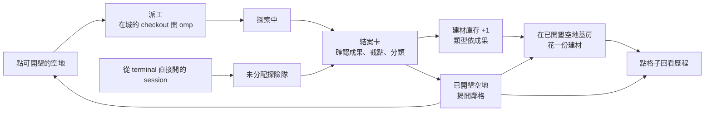

# herdr 開墾城鎮 mod 提案（v5.1）

> **狀態**：提案定稿前的版本，尚未實作。
> **歷程**：v1–v4 經過兩輪、共六份獨立審查（設計、技術、規格各兩次）與七輪使用者回饋。v5 以「開墾模式」為唯一主線；被放棄的方案列在附錄 A。
> **事實依據**：
> - herdr-app 0.1.16：`~/.config/herdr-app/herdr.d.ts`、`gpui-kit.d.ts`、`AGENTS.md`
> - `hc` 實測
> - omp v18.22.0：session 檔與內嵌原始碼
> - 參考專案：herdr-traveler、world-of-codecraft

## 0. 一句話

**每完成一份工作，城鎮就開墾出一塊地、蓋起一棟建築；城鎮就是你的工作史，可以回頭翻閱。**

## 1. 決定紀錄

| 議題 | 決定 |
|---|---|
| 主題 | 寫實中世紀（世紀帝國式）；單位是工匠，不是冒險者；不做等級 |
| 一格代表 | 一張完成的工單（開墾模式）；不再是一個檔案 |
| MVP 驗證目標 | **收藏**：成果累積成城鎮、可以回看；不做建築效果 |
| 建材 | **有類型**：每張結案的工單（含續作）依成果類型給一份；蓋房時花一份，類型決定能蓋什麼；民居收任何類型；沒有建材也能照常開墾（§11） |
| 開地與蓋房 | **兩個動作**：結案時那一格變成「已開墾空地」，這塊地永遠對應它自己的 session 結果；蓋房是之後另外的動作 |
| 研究型工單 | 給羊皮卷（可以蓋圖書館）；揭開範圍與一般工單相同 |
| 結案時 agent 還在跑 | 警告並確認後，以當下為截點結算；之後的費用另外歸屬 |
| 行會 | 不進遊戲規則。工單投入最多的 provider 決定建築的**派系風格**，只影響外觀（§9） |
| 熱點 | 只當可忽略的提示（MVP 不做） |
| 結案 | 由城主驗收；issue / MR 提示屬於後續功能 |
| 分類 | 規則式為預設；LLM 分類器（例如 omp `judge`）是擴充 |
| 城的身份 | space 資料夾所在 repo 的 git common dir |
| 格子 | 斜俯視 3/4 方格、四邊相鄰；邏輯座標與投影分開 |
| 平台 | 本機 macOS + omp；只有單一 `appHome()` |
| 產值 | API 等值，放在次要統計，不當成就 |

## 2. 定位與架構

### 2.1 和既有 layout 的差別

| | herdr-traveler | world-of-codecraft | 本提案 |
|---|---|---|---|
| 主體 | 側欄角色卡 | 固定的等角像素村莊 | 隨工作開墾的城鎮 |
| 強項 | agent 狀態、HP / SP | agent 的即時活動演出 | 可以回看的工作史 |
| 累積 | 無 | 只有 4 筆事件紀錄 | 每張工單一棟建築，附成果與歷程 |

本提案**不跟 world-of-codecraft 比 agent 演出**，差別在於：城鎮來自驗收過的真實成果，而且可以回看。

### 2.2 架構

- **一個新的 mod**，不 clone 內建 mod，也不綁定特定 layout。
- **城鎮地圖是一個 mod tab**：用 `tab.new {mod, props}` 開啟（`AGENTS.md:584-586`），可以放進 main、traveler、world-of-codecraft 任何一個 layout。
- **mod tab 不是唯一實例**，平台不保證一個 space 只有一個，要自己處理：
  - 「開啟城鎮」時，已經開著就切過去，沒有才新開。
  - 關掉 tab 只是關掉畫面，城還在。
  - 同時開著的多個畫面共用同一份帳本，靠 CAS 防止重複寫入（§13）。
- **一個 omp extension**：負責把 terminal 對到 session，並記錄用量（§6、§10）。
- **繪製**
  - herdr 用 gpui-kit：JS 描述元件，由 Rust 用原生 GPU 繪製；沒有 HTML、CSS、WebGL，也沒有 3D API（`AGENTS.md:35-47`）。
  - 立體感只能靠預先做好的圖片。

## 3. 核心循環

沒有建材時只能開墾、不能蓋房，但開墾永遠不消耗任何東西，所以真實工作不會被卡住。

## 4. 地圖規則

| 項目 | 規則 |
|---|---|
| 座標 | 邏輯座標 `(x, y)` 是無限平面，只畫出看得到的部分；投影與邏輯分開，之後要換等角或六角，只換投影與點擊判定 |
| 相鄰 | 只算上下左右 4 格 |
| 初始狀態 | 中心 `(0,0)` 是城鎮中心；上下左右 4 格可以開墾，其餘蓋迷霧 |
| 舊 repo | 開城時已經有 HEAD 的 repo，中心改用固定的「舊城區」圖，不依規模變化，也不回推歷史 |
| 揭開 | **結案時**（變成已開墾空地的那一刻），曼哈頓距離 1 以內的格子變成可開墾；蓋房不會揭開；已經揭開或已經佔用的格子不變 |
| 點擊 | 以地面格子為準，屋頂只是裝飾（`on_click` 綁在格子上） |
| 導覽 | MVP 只用原生雙軸捲動（`overflow_scroll`）；拖曳和縮放延後 |
| 非 git space | 沒有地圖；工單仍可結案、保存成果，但不給地圖獎勵 |

## 5. 狀態機

### 5.1 格子與工單的對應

| 格子狀態 | 工單狀態 | 離開條件 |
|---|---|---|
| 迷霧 | 無 | 被揭開 → 可開墾 |
| 可開墾 | 無 | 點擊 → 啟動中（先預留這一格） |
| 啟動中 | pending：已建立，尚未綁定 session | 綁定成功 → 探索中；失敗或取消 → 釋放這一格 |
| 探索中 | 施工中 / 暫停 / 失聯 | 開始結案 → 結案確認中；放棄 → 釋放這一格 |
| 結案確認中 | 已凍結結案快照，尚未提交 | 確認 → 已開墾空地；取消 → 回到施工中，不給任何東西 |
| 已開墾空地 | 至少有一張已結案工單 | 花一份建材蓋房 → 已建；開關聯工單 → 續作中 |
| 已建 | 至少有一張已結案工單 | 開關聯工單 → 續作中 |
| 續作中 | 有一張進行中的關聯工單 | 結案 → 歷程 +1、建材 +1，回到原本的狀態（空地或已建）；放棄 → 回到原本的狀態 |

### 5.2 不變量

- 每一格最多只有一張還沒結束的工單；同一個 session 不能同時綁兩張工單。
- agent 的 `working / blocked / done / idle` 只拿來顯示，**不會自動結案**（`done` 只是「完成了但你還沒看」）。
- 放棄的工單照樣保存已經發生的費用，但不算進成果產值。
- 「歷程次數」只算成功結案的工單，不帶來任何加成。
- 已經結案的成果快照不能再改：之後的 commit 不會讓它重新分類，修改規則表也不會回頭改既有建築。
- 一格的歷程只包含**在這一格施工過的工單**。建材只是庫存數字，不追蹤來源。
- 地面外觀依這一格**第一張工單的成果類型**呈現（§14），所以就算蓋上別種建築，看得出這塊地原本是怎麼開墾出來的。

## 6. 派工與 session 綁定

### 6.1 派工流程

1. 點擊可開墾的格子，先寫入一張 **pending 工單**，預留這一格。
2. 執行 `run("tab.new", {space, folder: <城的 checkout 路徑>, name: "開墾-<工單ID>", argv: ["env", "HERDR_RECLAIM_ORDER=<工單ID>", "omp"], focus: false})`。
   - 一定要帶 `folder`：新 tab 預設會跟著目前 focus 的 pane 的目錄，可能已經切到別的 repo（技術 R2 F3；S1 實測 space 的 `folder` 指向別的 repo）。
   - `cityId` 是 git common dir，代表城的身份；`folder` 是實際的 checkout，兩者分開存。
3. `run()` 回傳 `null`，所以靠 extension 回報綁定（S1 驗證過）：
   - extension 從環境變數讀到工單 ID，寫進 `terminals/<terminal>.json`。
   - mod 找到帶有這個工單 ID、而且更新時間晚於工單建立時間的對應檔，存下 terminal 位址與 session ID。tab 名稱只當顯示用。
   - 同一個 terminal 之後 `/new` 出來的 session 也帶同一個工單 ID，所以只綁**第一個**。
4. 綁定逾時就顯示失敗並釋放格子。連點同一格只會建立一張工單。

### 6.2 omp extension 的對應檔

- 新寫一個 extension，不沿用內建的 `herdr-omp-agent-state.ts`：內建的只在 `HERDR_ENV`、`HERDR_PANE_ID` 存在時啟用，而且是經由 socket 回報；herdr-app 裡實際可用的環境變數是 `HC_TERMINAL_ID`。
- 在 `session_start`、`session_switch`、`agent_start` 時寫出 `{terminal, sessionId, generation, updatedAt}`，並保留內建版排除 nested omp 的邏輯。
- **以 session ID 為主鍵，不依賴路徑。**
  - `/move` 不會觸發 `session_switch`（技術 R2 F1），所以路徑可能失效。
  - session 檔名本身就含 session ID（`<時間戳>_<id>.jsonl`），路徑失效時可以用 ID 重新找到檔案。
- 綁定建立後，工單就固定綁這個 session ID。`/resume` 換成別的 session 時，新 session 的費用不算到這張工單。

### 6.3 未分配探險隊

| 項目 | 規則 |
|---|---|
| 範圍 | 本機上、第一次被看到時就在這座城的 checkout 裡、還沒綁定工單的**主** session |
| 排除 | subagent、其他城的 session、已經處理過的 session；不自動匯入歷史檔 |
| 持久性 | 以 session ID 追蹤；terminal 關掉，紀錄還在 |
| 可做的處理 | 結案並放到某一格、「稍後布置」、「不納入城鎮」。任何一種都不用假結案 |

## 7. 結案卡

一張卡片完成所有步驟：

### 7.1 截點

- agent 還在跑時顯示警告，確認後才能繼續。
- 截點是**各來源已讀到的完整事件游標**，不是牆上時鐘的時間。
- 截點之後產生的費用不會改動這張工單，而是記為「未分配」，之後可以追查。

### 7.2 成果候選

- 開工時記錄：checkout 路徑、HEAD（或「沒有 HEAD」）、當時已有的未 commit 變更。
- 結案時列出：
  - 基準之後的 commit
  - staged、unstaged、untracked 檔案（扣掉開工時就已存在的那些）
- **城主勾選哪些屬於這張工單。** 同一個 repo 同時有別的工單時，候選清單會混在一起，不用時間範圍自動歸屬。
- 清單是空的時，要分兩種情況：
  - 你確認這次沒有改程式 → 可以走研究型
  - 讀取失敗 → 顯示錯誤，**不能冒充成研究**

### 7.3 研究型工單

- 必須填結論，空白不能提交；也可以附上連結。
- 給一份羊皮卷，可以拿來蓋圖書館。那一格的地面是「勘查地」，可以續作，也有造價。

### 7.4 分類與建材類型

- 依 §8 的規則表算出成果類型，只列分數大於 0 的，最多 3 個，再固定加一個「其他」。
- 城主一定要親自選一個。混合型的工單也只給**一份**建材，不按比例拆成好幾份。
- 選「其他」時，由城主指定給哪一種建材。

### 7.5 提交

- 一次提交以下所有東西，一起成功或一起失敗：工單終態、成果快照、分類結果、規則版本、建材 +1、格子變成已開墾空地、揭開的範圍、計費游標與金額。
- 未分配探險隊結案時，要先選一塊可開墾的格子當它的空地；選「不納入城鎮」就沒有空地，也沒有建材。

### 7.6 蓋房（獨立動作）

- 點一塊已開墾空地 → 只列出庫存夠的建築 → 選定後扣一份建材。
- 一次提交：建材 −1、格子變成已建、建築類型、派系風格。
- 庫存是零時，蓋房按鈕停用，並提示「可以先去開墾」。

## 8. 分類規則與建築對照

### 8.1 成果類型、建材與建築

| 成果類型 | 判定（路徑 glob，大小寫不分，比對 repo 相對路徑） | 建材 | 地面外觀 |
|---|---|---|---|
| 測試 | `**/tests/**`、`**/__tests__/**`、`**/test_*`、`**/*_test.*`、`**/*.spec.*`、`**/*.test.*` | 石材 | 採石地 |
| 文件 | `**/*.md`、`**/*.rst`、`**/docs/**` | 羊皮卷 | 抄寫地 |
| 設定 | `**/*.json`、`**/*.yml`、`**/*.yaml`、`**/*.toml`、`**/.*` | 鐵料 | 礦地 |
| 程式 | 不符合以上任何一項 | 木材 | 伐木地 |
| 研究 | 城主確認沒有程式變更，並填寫結論 | 羊皮卷 | 勘查地 |
| 其他 | 城主手動選 | 城主指定 | 一般空地 |

| 建築 | 需要的建材 |
|---|---|
| 工坊 | 木材 ×1 |
| 城牆 | 石材 ×1 |
| 圖書館 | 羊皮卷 ×1 |
| 倉庫 | 鐵料 ×1 |
| 民居 | 任何一種 ×1（萬用建築，避免為了湊稀有建材刻意開某類工單） |

### 8.2 計算規則

- **優先序**：測試 > 文件 > 設定 > 程式。每個檔案只歸一類，例如 `tests/README.md` 算測試、`docs/config.json` 算文件。
- **分數**：該類在勾選檔案中所佔的比例，以不重複的路徑計算。
- **rename**：以新路徑為準；**刪除的檔案**也照樣計入。
- **同分**：依上面的優先序排列。
- **規則表**：可以編輯，有版本號；分類時用的版本會存進成果快照。

## 9. 派系風格（行會的位置）

- **投資**：一張工單裡，各 provider 的投入。
  - 費用全部已知時，用 API 等值計算。
  - 只要有一個費用未知，例如 Databricks 的 cost 是 0，就一律改用「不含 cache 的輸入 + 輸出 token」比較。
  - subagent 也算進去。
- **風格**：一棟建築的派系風格，取**這一格**所有工單的累積投資最多的 provider，與蓋房時花的建材是從哪裡來的無關。續作讓另一個 provider 超過時，會顯示「改建」，風格跟著換。
- **同分**：取主 session 的 provider。
- **完全不影響**揭開範圍、建材或任何規則，所以不會讓你為了遊戲改選 model。
- **美術**：每種建築 × 每個派系各一張圖，另外準備一套「無派系」風格，給無法判定的情況用。

## 10. 產值（API 等值）

- **來源**（S2 驗證過）：omp extension 在 `turn_end`、`agent_end` 等時機，從記憶體中的 `sessionManager.getEntries()` 依 provider 累加用量，寫出 `sessions/<sessionId>.json`。
  - 只算 assistant 的 `message.usage` 和 `model_usage` 兩種事件，不加總 task 的彙總。
  - subagent 也會載入 extension，自己寫摘要，用 `rootSessionId` 歸到主 session。
  - 不需要解析 session 檔，所以 `readTextFile` 1 MiB、`exec` 8 MiB 的上限都不成問題。
  - 工單的區間增量 = 截點時的累計 − 綁定時的累計（以 provider 為單位）。
- **造價**
  - 一棟建築的造價 = 這一格所有已結案工單的**區間增量**總和。
  - 續作只計新增的區間，不重算整個 session。
  - 已知金額和未知部分分開存；有未知時只顯示「已知部分」。
- **本月統計**
  - 依結案月份，時區固定為 Asia/Taipei，標示為「本月已驗收 API 等值 ÷ 月費」。
  - 沒有填月費，或月費 ≤ 0 時，顯示「無法計算」。
  - 放在次要統計，不當成就指標：重試越多、用越貴的 model，這個數字就越高。

## 11. 建材（有類型）

| 情況 | 建材變化 |
|---|---|
| 一般工單或續作結案 | 依成果類型 +1 |
| 蓋房 | 依建築 −1 |
| 未分配探險隊選「不納入城鎮」 | 0 |
| 取消結案、放棄 | 0 |
| 重複操作 | 不重複收支 |

**限制**

- 一張工單只給一份，與 diff 大小、token、行數無關。
- 一定有萬用建築（民居），手上有什麼都能蓋。
- 沒有匯率、沒有被動產出、沒有庫存上限；**開墾永遠免費**，不會擋到任何真實工作。
- 建材就是各類型的計數，不記錄來源、也不追蹤用在哪裡；去重靠 operation ID（§13）。
- **試玩要觀察**：會不會為了蓋圖書館、倉庫，刻意多開研究或設定類的工單（§17.2）。

## 12. 回看

點任何一棟建築，打開歷程面板：

- 每一張工單的目標、結論、勾選的成果檔案與 commit
- 分類與規則版本
- 截點、造價（已知 / 未知）
- 地面的成果類型；有蓋房的話，蓋了什麼建築、花了哪一種建材
- 派系投資比例

這是本提案和其他 layout 的主要差別，必須在 MVP 裡做到。

## 13. 存檔

### 13.1 檔案與寫入

- 每座城一份小 ledger，放在 `appHome()/data/<mod>/cities/<cityId-hash>.json`。
- 不存原始 transcript，避免檔案超過 1 MiB 讀不回來。
- 每次操作都整份檔案用 `writeTextFile(path, text, expected)` 做 CAS 提交（技術 R1 F5、R2 存檔）。發生衝突時：重讀 → 重新檢查前提 → 套用同一個 operation ID。

### 13.2 欄位

| 層級 | 欄位 |
|---|---|
| 城 | `schemaVersion`、`rulesVersion`、`cityId`、checkout 路徑、格型、相鄰規則、時區、月費 |
| 格子 | 座標、狀態、地面成果類型、建築類型、派系、已結案工單 ID 清單、進行中的工單 ID |
| 建材庫存 | 各類型的數量：木材、石材、羊皮卷、鐵料 |
| 工單 | ID、格子 ID、關聯工單 ID、狀態、session ID、terminal 位址、tab ID、checkout、基準（HEAD 與 dirty baseline）、計費游標 |
| 結案快照 | 勾選的成果、結論、分類與規則版本、所選成果類型（給出的建材類型）、截點、已知金額與未知部分、派系投資、結案時間 |
| 未分配紀錄 | session ID、首次觀測時間、所屬的城、處理狀態 |
| 已處理 operation ID | 用來去重 |

## 14. 美術（mock 主題包）

| 素材 | 數量 |
|---|---|
| 地形：草地、迷霧、可開墾標記 | 3 |
| 城鎮中心、舊城區 | 2 |
| 已開墾空地：伐木地、採石地、抄寫地、礦地、勘查地、一般空地 | 6 |
| 建築：5 種 × 4 套派系風格（Anthropic、OpenAI、Google、無派系） | 20 |
| 建材圖示：木材、石材、羊皮卷、鐵料 | 4 |
| 探索中標記、結案確認中標記 | 2 |
| **合計** | **約 37 張** |

- 透明背景、固定寬度，建築可以往上超出格子。
- 素材放在 `mods/<mod>/themes/<name>/`；存檔就會自動重載（`AGENTS.md:903-906`）。
- 全部是靜態圖，沒有動畫 timer。

## 15. 先行技術驗證

正式開工前先做以下四項，任何一項不通過就先修改提案：

| # | 驗證什麼 | 最小做法 | 通過條件 |
|---|---|---|---|
| S1 | 派工與 session 綁定 | 只做文字狀態面板 + extension | 帶 `folder` 開出 omp；拿到唯一的 terminal 與 session ID；tab 改名不會斷開綁定；`/resume` 不會串帳；`/move` 後立刻結案仍能找到正確的 session 檔。**✅ 2026-11-19 通過**（§15.1） |
| S2 | 用量紀錄 | extension 寫用量 + 拿既有的大檔對帳 | 和直接解析主檔加子檔的結果一致；兩種事件各只計一次；確認 extension 收不收得到 subagent 的用量。**✅ 2026-11-19 通過**；大型 session resume 的效能未測（§15.1） |
| S3 | 成果候選與 CAS | 唯讀 git helper；兩個畫面同時操作同一份測試 ledger | 同一個 checkout 有 committed、未 commit、多張工單並行的變更時，候選清單正確；兩個畫面同時結案只會入帳一次；寫到一半重啟後狀態一致 |
| S4 | 地圖 | 先做 3×3 高矮交錯的 mock 建築，再做 300 格 | 溢出的圖片不會攔錯點擊；捲動與狀態更新的延遲記錄下來，和空白 mod 比較（門檻在開工前固定） |

### 15.1 S1、S2 結果（2026-11-19）

**程式**

- `omp-extension/herdr-reclaim.ts`
- `mod/herdr-reclaim/`（文字面板）
- `spikes/s2-reconcile.ts`
- `tools/install.sh`

**測試環境**：`/tmp/herdr-reclaim-sandbox`（git）。主 session 用 Sonnet，subagent 走 Databricks。

| 檢查 | 結果 | 證據 |
|---|---|---|
| 帶 `folder` 開出 omp | ✅ | session 的 cwd 是 `/tmp/herdr-reclaim-sandbox`。space 自己的 `folder` 是 `/Users/kk/projects/Obsidian-Note`，兩者不同 |
| 綁定唯一 terminal 與 session | ✅ | 透過 mod 派工兩次：工單 `omwn0ptq4` → t50、`omwn0rbla` → t51；pane 對照一致 |
| tab 改名 | ✅ | 改名後對應檔不變（綁定不依賴名稱） |
| `/new` 不串帳 | ✅ | 對應檔 `reason: session_switch:new`，換成新的 session ID；原 session 的用量（7 筆，$0.0711）在新 session 跑完後不變 |
| `/resume` | ✅ | `reason: session_switch:resume`，換回原 session ID |
| `/move` 後立刻結案 | ✅ | `/move` 不觸發任何事件，對應檔路徑會過期，直到下一次 `agent_start`；但用量摘要以 session ID 為鍵，結案不需要讀檔；需要讀檔時，用 ID 一定找得到搬走後的檔案 |
| subagent 用量 | ✅ | subagent 也會載入 extension（`hasUI: false`），自己寫摘要；用 `rootSessionId` 歸戶（path 在 `/move` 後會過期，ID 不會） |
| 對帳 | ✅ | `s2-reconcile` 對三個 session 家族逐 provider 比對 token、cost、筆數，全部一致；包含 assistant 與 `model_usage` 兩種事件，以及 Databricks cost=0 的未知價格標記 |
| 兩個城鎮畫面同時寫 | ✅（修正後） | 第一版出現 `writeTextFile` stale 錯誤（兩個 bindPending 同時寫）。改成序列化並以 CAS 重試後，兩個畫面都正確；沒有寫入動作的畫面也會從檔案刷新 |

**設計因此修改**

- **派工綁定改用環境變數**：`argv: ["env", "HERDR_RECLAIM_ORDER=<工單ID>", "omp"]`，extension 把工單 ID 寫進對應檔，比用 tab 名稱找 terminal 可靠。
  - 同一個 terminal 之後 `/new` 開的 session 會繼承同一個工單 ID，所以工單只綁**第一個**回報的 session。
  - `herdr-app do tab.new` 會回傳 tab 與 terminal，但 mod 內的 `run()` 回傳 `null`，所以 mod 端仍要靠 extension 回報。
- **用量不解析檔案**：extension 直接讀 omp 記憶體中的 `sessionManager.getEntries()`，原本擔心的大檔與 1 MiB / 8 MiB 上限因此不成問題，也不需要額外的 runtime。
- **城的 checkout 必須自己記**：`SpaceInfo.folder` 只是新 terminal 的預設位置，實測與 space 名稱指向不同 repo。

**未涵蓋**

- 已經在跑的 omp session 要重開才會載入 extension。
- 大型 session（數千筆 entry）在每個 turn 重新加總的成本未測。
- Claude Code、Codex 不在範圍內。

## 16. MVP 範圍

**包含**：§4–§14 的全部內容。

**排除**

- 建築效果、策略取捨
- 書記官入口、LLM 分類器
- 熱點、道路
- 勞動力與額度、issue / MR
- 等角與六角、拖曳與縮放、動畫
- 王國地圖、遠端與 Windows、多 client

## 17. 驗收

### 17.1 功能驗收（交給 QA）

1. **初始化與揭開**
   - 沒有 HEAD 的 repo：中心 `(0,0)`，只有上下左右 4 格可以開墾。
   - 有 HEAD 的 repo：顯示固定的舊城區圖。
   - 重開後座標和類型都不變；非 git space 顯示「沒有地圖」，但工單照樣可以結案。
2. **派工**
   - 連點同一格只建立一張工單、開一個 omp tab，而且開在城的 checkout。
   - 啟動或綁定失敗時看得到，格子會被釋放。
   - agent 的狀態只影響顯示，不會自動結案。
   - agent 消失後，工單還在，可以恢復或放棄。
3. **session 切換**
   - tab 改名不會斷開綁定。
   - `/resume` 之後產生的費用不算進原工單。
   - `/move` 後不再對話、直接結案，仍讀得到正確的來源。
4. **未分配**
   - 準備四種 session：同一座城、還沒綁定的主 session；別的 repo 的 session；subagent；歷史 session。
   - 只有第一種出現在清單上。
   - 認領之後，不能被其他格或其他城再認領。
5. **成果、分類與建材**
   - 同一個 checkout 裡同時有：開工前就存在的 dirty 檔、A 工單未 commit 的變更、B 工單的 commit。A 結案時三者都會列為候選，但只保存城主勾選的那些。
   - `tests/README.md`、`docs/config.json`、`config.yaml`、`src/main.ts` 依優先序分別給石材、羊皮卷、鐵料、木材。
   - 混合型工單只給一份建材。
   - 取消結案時，什麼都不會增加。
   - 讀取失敗時，不能當成研究結案。
6. **研究、續作與造價**
   - 研究的結論空白時不能提交。研究結案後地面是勘查地、給一份羊皮卷，揭開範圍與一般工單相同。
   - 計費情境：
     - 首張工單：主 session 費用 2 + subagent 1 → 造價 3
     - 同一個 session 續作，新增 2 → 歷程 2、造價 5（不是 8），建材再 +1
   - 結案時 agent 還在跑：截點之後的費用不會改動這張工單。
   - 月份：10 月開工、11 月結案的工單算 11 月；月費 100、產值 3 → 3%；有費用未知時只顯示已知部分。
7. **蓋房與派系**
   - 庫存只有羊皮卷時，空地上只列出圖書館和民居；蓋好後羊皮卷 −1。
   - 庫存是零時，蓋房停用，但開墾照常可以用。
   - 在任一已開墾空地蓋房，這一格的歷程仍然只有在這格施工過的工單。
   - 主 session 投資 Anthropic 2、subagent 投資 OpenAI 3 → 風格為 OpenAI。續作後 Anthropic 累積超過 OpenAI → 顯示改建，風格換成 Anthropic。
   - 派系不會改變任何數值。
8. **持久與冪等**
   - 分別在探索中、結案確認中、結案提交前後、蓋房提交前後重啟，結果要嘛全部套用、要嘛全部沒套用，不會只套用一半。
   - 同一次結案或蓋房送三次，或同時開兩個城鎮畫面，都只會生效一次。
   - 點任何一格都能回看完整歷程。

### 17.2 試玩（另外判定；功能全部通過不代表 MVP 成功）

- **期間**：連續 5 個工作日，至少完成 10 張真實工單，涵蓋程式、研究、續作，以及從 terminal 直接開的 session。
- **記錄**：每次結案多花的時間、略過或不納入的原因、是否主動回來看城鎮、能不能從建築找回正確的成果。
- **建議門檻**（開工前固定）：
  - 結案額外時間的中位數 ≤ 30 秒
  - 至少 3 天主動回看
  - 所有成果都能追溯
  - 沒有出現「為了城鎮而拆單、改 model、多開研究單」
  - 願意下一週繼續用
- **判讀**：試玩不通過時，結論是「流程可用，但收藏價值不成立」，要先改設計，不要繼續擴充。

## 18. 後續候選（MVP 驗證後再排序）

- **策略取捨**：同樣揭開格數，選「往一個方向延伸」或「往兩側展開」，地圖上預先標出地標。
- **書記官入口**：先討論需求，再用 decide 分類，核准後才派工。
- **LLM 分類器**：外部命令或 omp `judge`。
- **熱點提示**：掛在改過該檔案的建築上。
- **道路**：兩張工單改過同一批檔案時自動連線。
- **額度資訊**：`omp usage`，例如「錯過的開墾機會」，只顯示、不懲罰。
- **其他**：issue / MR 接入、王國地圖（machine 與 space）、等角或六角投影、動畫（要附開關）。

## 19. 審查紀錄

| 輪次 | 判定 | 主要問題 | 處理 |
|---|---|---|---|
| R1 設計 | 值得做小型縱切 | 虛構稅收混在真實帳裡；把檔案存在當成品質；修理反而提高熱點；研究交不出成果 | 改成開墾模式；砍掉稅收；研究要有結論 |
| R1 技術 | blocker | `lsof` 不可靠；大檔超過讀取上限；計費事件有兩種；平台差異 | extension 以 session ID 綁定；記錄用量；只做本機 macOS |
| R1 規格 | 不完整 | 身份、生命週期、對帳區間、存檔沒定義 | §5、§7、§13 |
| R2 設計 | 只能驗證收藏 | 建材沒有出口；研究和續作有拆單誘因；缺回看 | 建材改為落成時扣除；研究揭開範圍與一般相同；歷程不給加成；新增 §12 |
| R2 技術 | incorrect（0.90） | `/move` 不會觸發事件；成果歸屬混雜；派工沒帶 `folder` | §6.1、§6.2、§7.2、§15 |
| R2 規格 | incorrect（0.96） | 狀態機、揭開規則、分類對照、續作計費、未分配範圍、存檔 | §4、§5、§6.3、§8、§10、§13、§17 |
| v5.1 使用者 | — | 建材要有類型、限制能蓋什麼；開地和蓋房分開，但一塊地只對應它自己的 session | §1、§3、§5、§7.4–7.6、§8.1、§11、§17 |

## 附錄 A：放棄的方案

| 方案 | 放棄原因 |
|---|---|
| 一個檔案一格 | 舊 repo 一開就是滿城，看不出哪些是這次做的；大 repo 有上千格；座標生命週期複雜；檔案大小會鼓勵寫長檔案 |
| 冒險者與等級 | 等級改變不了真實能力，選誰去的取捨其實是選 model |
| 國庫與稅收 | 虛構收入和真實費用混在同一本帳；訂閱制用戶真正的限制是 rate limit |
| 勞動力（rate limit）機制 | 開墾模式下花費都在探索階段，派哪個行會不影響結果；讓行會影響產出會扭曲 model 選擇 |
| 城內迷霧 | 城主轄下不應該有看不到的建築；新專案也沒有意義 |
| 用 `lsof` 對應 session | 同一個 process 會同時開著 subagent 的檔案；切換 session 時會先關檔 |
