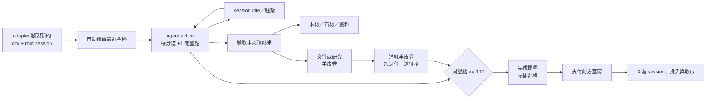

# herdr 開墾城鎮 mod 提案（v6）

> **狀態**：提案定稿前的版本，尚未實作。
> **歷程**：v1–v5.2 經過兩輪獨立審查與多輪使用者回饋。v6 將核心身份從工單改為 `(cityId, rootSessionId)` 遠征：新 root session 自動探索土地、事件驅動累積投入、成果另行收成。被放棄的方案列在附錄 A。
> **事實依據**：
> - herdr-app 0.1.16：`~/.config/herdr-app/herdr.d.ts`、`gpui-kit.d.ts`、`AGENTS.md`
> - `hc` 實測
> - omp v18.22.0：session 檔與內嵌原始碼
> - 參考專案：herdr-traveler、world-of-codecraft

## 0. 一句話

**每個 agent session 都是一支遠征隊：工作期間探索土地，驗收成果後收成資源，最後把可回看的工作史長成一座城。**

## 1. 決定紀錄

| 議題 | 決定 |
|---|---|
| 主題 | 寫實中世紀（世紀帝國式）；單位是工匠，不是冒險者；不做角色等級 |
| 一格代表 | 一組 `(cityId, rootSessionId)` 遠征；同一 root session 在不同 city 各有一格，subagent 併入 root、不另開地 |
| MVP 驗證目標 | **收藏**：session、成果與投入累積成城鎮，可以回看；不做建築效果 |
| 自動選地 | 第一次看到新的 `(cityId, rootSessionId)`，依固定 BFS 順序選最近的未佔用格；地形與路線有差異後才考慮手動選路 |
| 土地進度 | root session 與可歸戶 subagent 的 active interval 聯集每分鐘 +1 點；100 點完成開墾。進度只表示投入與成本，不表示品質或產值 |
| 成果資源 | 驗收成果後可同時取得木材、石材、鐵料；數量依成果種類與數量，不依 token、時間或 model |
| 羊皮卷 | 文件成果或經驗收的無檔案研究可產生；不是建築材料。羊皮卷可消耗以加速任一遠征格，暫定 1 卷 +10 點 |
| 收成與開墾 | 兩個獨立進度：成果可以多次收成；土地達 100 點才完成開墾並揭開鄰格 |
| 無成果 session | 格子保留在探索／駐紮狀態，直到使用者手動撤回；不自動逾時 |
| 行會 | provider 真實額度若可取得就顯示成可調度人力；遠征投入最多的 provider 決定派系風格 |
| CLI | OMP 是參考 adapter；Codex、Claude Code 需各自 adapter。手寫程式與沒有 adapter 的 shell 不納入 |
| 分類 | 規則式為預設；LLM 分類器（例如 omp `judge`）是擴充 |
| 城的身份 | cwd 所在 repo 的 canonical git common dir；worktree 屬於原 repo 的同一座城 |
| 格子 | 斜俯視 3/4 方格、四邊相鄰；邏輯座標與投影分開 |
| 平台 | 本機 macOS；只有單一 `appHome()` |
| 產值與用量 | API 等值放在次要統計，不當成就；token 只影響派系、造價與研究羊皮卷，不產生木材、石材或鐵料 |

## 2. 定位與架構

### 2.1 和既有 layout 的差別

| | herdr-traveler | world-of-codecraft | 本提案 |
|---|---|---|---|
| 主體 | 側欄角色卡 | 固定的等角像素村莊 | session 自動遠征、隨成果成長的城鎮 |
| 強項 | agent 狀態、HP / SP | agent 的即時活動演出 | 可以回看的 session、投入與成果史 |
| 累積 | 無 | 戰報保存最多 40 筆、畫面顯示 4 筆；不保存 session ID 與成果 | 每個 session 一格，可多次收成並持續開墾 |

本提案**不跟 world-of-codecraft 比 agent 演出**，差別在於：城鎮來自真實 session、驗收成果與可觀測投入，而且可以回看。

另有三個同類 layout（herdr-kaiju、herdr-middle-earth、frieren）；五者的逐項比較與可借用做法見 [competitor-analysis.md](competitor-analysis.md)。截至 2026-11-19，沒有任何一個做跨 session 的成果累積。

### 2.2 架構

- **一個新的 mod**，不 clone 內建 mod，也不綁定特定 layout。
- **城鎮地圖是一個 mod tab**：可以放進 main、traveler、world-of-codecraft 等 layout。
- **一個 adapter protocol**：各 CLI adapter 將 session ID、cwd、active interval、用量與 parent session 關係寫成同一格式（§6）。
  - OMP extension 是參考實作。
  - Codex、Claude Code 必須先驗證各自可取得的 hook 與用量欄位；缺少能力時明示未知，不推估。
- **兩層資料**
  - adapter state：由 CLI 程序持續寫；herdr 關閉時也照常累積。
  - city ledger：由 mod 寫入格子、收成、資源與建築；同時開啟的多個畫面靠 CAS 防止重複寫入。
- **繪製**
  - herdr 用 gpui-kit：JS 描述元件，由 Rust 用原生 GPU 繪製；沒有 HTML、CSS、WebGL，也沒有 3D API。
  - 立體感靠預先做好的靜態圖片；進度條以原生元件呈現。

## 3. 核心循環



成果產量與投入時間／token 分開：短時間完成有效成果仍能立即收成；只是土地可能尚未完成開墾。羊皮卷提供遊戲內的加速選擇，但不影響真實工作能否繼續。

## 4. 地圖規則

| 項目 | 規則 |
|---|---|
| 座標 | 邏輯座標 `(x, y)` 是無限平面，只畫出看得到的部分；投影與邏輯分開 |
| 相鄰 | 只算上下左右 4 格 |
| 初始狀態 | 中心 `(0,0)` 是城鎮中心；新遠征以 BFS 選最近的未佔用格，同距離固定依北、東、南、西排序 |
| 預留 | 預留格可以位於迷霧中，顯示遠征標記；預留不揭開鄰格，也不算正式領土 |
| 揭開 | 遠征格達 100 點時完成開墾，曼哈頓距離 1 以內的格子變成可見；既有格不變 |
| 舊 repo | 開城時已經有 HEAD 的 repo，中心使用固定「舊城區」圖，不回推歷史 |
| 點擊 | 以地面格子為準，屋頂只是裝飾；點格子可看進度、收成、投入與建築 |
| 導覽 | MVP 只用原生雙軸捲動；拖曳和縮放延後 |
| 非 git cwd | 不建立 city 或遠征格；adapter 可以保留 session 狀態，但不納入地圖 |

## 5. 狀態機

### 5.1 遠征格

| 格子狀態 | session 狀態 | 行為 |
|---|---|---|
| 預留 | 第一次發現 `(cityId, rootSessionId)` | 自動配置最近空格，記錄 baseline 與首次觀測時間 |
| 探索中 | root 或可歸戶 subagent 有 active interval | active interval 聯集每滿一分鐘 +1 點；顯示目前 provider |
| 駐紮 | root session idle、關閉或移到其他 city | 保留格子與進度；`/resume` 後繼續，不自動撤回 |
| 可收成 | 有尚未認領的成果候選 | 可以在未滿 100 點時收成；收成不會自動完成土地 |
| 已開墾空地 | 開墾點 ≥100 | 揭開鄰格；可以蓋房；session 之後仍可 resume 與再次收成 |
| 已建 | 已支付完整建築配方 | 建築保留；後續收成加入同一格歷程 |
| 已撤回 | 使用者手動放棄、尚未開墾且從未收成 | 釋放座標、封存這一代遠征；不退回已用羊皮卷，也不再吸收後續活動 |

### 5.2 不變量

- 同一座城的 `(cityId, rootSessionId)` 同時最多一格；`/resume` 回到目前這一代遠征。
- subagent 只有在 adapter 能提供 parent 關係時才併入 root；不為 subagent 建格。無法分辨 child 的 adapter 只能輸出 top-level session。
- 同一 root session `/move` 到另一座城時，舊格變成駐紮；新 `(cityId, rootSessionId)` 建立或恢復另一格。移回舊城時繼續舊格。
- session 沒有自動「完成」狀態；成果可以多次收成，每次只處理未認領的 claim key。
- 格子達 100 點只完成開墾，不自動產生資源；資源只來自驗收成果。
- active time 使用 root 與可觀測 subagent interval 的**聯集**，不把平行 agent 的分鐘相加。
- provider token／費用不產生木材、石材或鐵料。
- 只有「未開墾且從未收成」的格子能撤回。撤回後 resume 保持忽略；手動重新派遣會建立 `generation + 1`，自然點與加速點歸零，以當下 usage 游標與 checkout baseline 重新開始。忽略期間的時間、用量與成果不回補。

## 6. Session 遠征與 adapter

### 6.1 共同 adapter 格式

每個 adapter 最少輸出：

```ts
interface HerdrActivity {
  cli: "omp" | "codex" | "claude";
  sessionId: string;
  parentSessionId?: string;
  visits: Array<{
    visitId: string;
    seq: number;
    cwd: string;
    startedAt: number;
    endedAt?: number;
    activeStartedAt?: number;
    lastHeartbeatAt?: number;
    activeIntervals: Array<{ start: number; end?: number }>;
    usageAtStart?: Record<string, Usage>;
    usageCurrent?: Record<string, Usage>;
  }>;
  ackedThroughSeq: number;
  updatedAt: number;
}
```

- `sessionId` 必須能在 resume 後維持相同；只有 top-level session 會建立遠征格。
- 每次 cwd 改變都結束舊 visit 並新增一筆，即使新舊 cwd 屬於同一 city；mod 再以 canonical git common dir 決定各 visit 的 city。
- 每筆 visit 保存 cwd、interval 與累計 usage 的起訖快照，因此 herdr 關閉期間多次 `/move` 仍可重播分界。
- `parentSessionId` 存在時，activity 併入 root；adapter 無法提供 parent 關係時，不得把可能的 child 當成獨立 top-level session 輸出。
- `usageCurrent` 是可選能力；缺少時顯示未知。
- adapter 只能在 mod 以 CAS 保存 visit、interval 與 usage 後提高 `ackedThroughSeq`；之後才可刪除已確認的原始事件。city ledger 保留合併後 interval，避免 late child 重疊造成重算錯誤。

### 6.2 OMP 事件

- `session_start`、`session_switch`：建立或切換 session 身份；只有 `hasUI: true` 的 root 自動建格。
- `agent_start`：若 cwd 與上一筆不同，先以當下累計 usage 結束舊 visit，再以相同值建立新 visit；接著寫入 `activeStartedAt` 與第一個 heartbeat。
- agent active 時每分鐘更新 `lastHeartbeatAt`，避免程序在長回合中崩潰而遺失整段時間。
- `agent_end`：以最後 heartbeat／結束時間封閉 interval 並更新 `usageCurrent`。
- `turn_end`、`session_shutdown`：刷新完整用量與最後狀態；未正常封閉的 interval 最多只算到最後 heartbeat。
- herdr 是否開啟不影響 extension 累積；mod 重開後依 visit seq 重播，不能只讀最後 cwd。
- OMP 參考實作會使用 `hasUI`、`getSessionId()`、`getCwd()`、`getEntries()`、`getHeader().parentSession` 等專用介面；其他 CLI 不能假定具備同等資料。

### 6.3 `/new`、`/resume`、worktree 與 `/move`

- `/new`：新的 root session ID，在目前 city 自動預留另一格。
- `/resume`：相同 root session ID；在目前 city 恢復目前 generation。已撤回的配對保持忽略，除非使用者手動重新派遣。
- worktree：實際 checkout 路徑不同，但 canonical git common dir 相同，所以仍是同一座城；cwd 改變仍建立新 visit 與獨立 checkout baseline。
- `/move`：不要求指令本身發事件；下一個 `agent_start` 以新 cwd 建立 visit。移動發生於 agent idle 時，usage 起訖快照把下一輪完整歸到新 visit。
- 從 herdr 外直接啟動的支援 CLI session 也會自動出現在城裡，不需要先從地圖派工。
- 手寫程式與沒有 adapter 的 shell 明確排除；不以檔案監聽猜測 session。

## 7. 收成卡

session 不需要結案。每次有新成果時，城主可以建立一筆不可變的收成快照。

### 7.1 截點與成果候選

- 每一代遠征依 checkout 保存獨立 baseline：首次遇到該 checkout 時記錄 realpath、HEAD（或沒有 HEAD）與逐路徑 blob／缺席狀態。
- 切換到同 repo 的另一個 worktree 只建立新 visit，不覆蓋舊 checkout baseline；未收成果仍留在原 checkout 的候選清單。
- 收成卡按 checkout 分組，列出各自 baseline 後的 commit、staged、unstaged、untracked、deleted 成果。
- 收成後只把**已勾選路徑**的 baseline 推進到當下 blob／缺席狀態；未勾選路徑維持原 baseline，避免其他 session 的變更被吃掉。
- 同一 checkout 有多個 session 時，候選可能混在一起；城主勾選真正屬於這格的成果，不按時間範圍自動歸屬。
- agent 還在 active 時可以收成，但必須確認；截點使用完整事件游標與當下成果內容。
- 已被同一座城其他格認領的 claim key 只能連結歷程，不能再次發資源。

### 7.2 一般成果

- 依 §8 規則把每一項勾選成果分類；混合成果可以同時取得多種資源。
- 收成卡顯示資源向量，例如 `{木材: 10, 石材: 20, 鐵料: 0, 羊皮卷: 1}`。
- 代表成果類型只決定地面外觀：預設取產量最高的類型，同分依分類優先序；城主可以覆寫。
- 收成不要求土地已滿 100 點，也不改變 active time。

### 7.3 無檔案變更的研究

- 必須保存可回看的研究成果，例如結論、比較、決策或附摘要的連結；空白不能收成。
- 只計算這個 visit 在**前一次任何收成**之後尚未結算的 `input + output` token；cache read／write 不算，程式成果期間的用量不能留到之後改報研究。
- 暫定每累積 100,000 合格 token 產生羊皮卷 ×1，不足部分留在該 city 的研究計量器；這是投入指標，不代表研究品質。
- 讀取失敗不能冒充研究；用量未知的 adapter 只能保存研究歷程，不能自動換算羊皮卷。

### 7.4 原子提交

- 一次 CAS 提交：收成快照、claim key、逐 checkout／逐路徑 baseline 更新、分類與規則版本、資源向量、代表成果類型、usage 結算游標、派系投資、研究 token 餘額。
- operation ID 防同一次提交重送；claim key 防同一成果重複收成。

### 7.5 蓋房與加速

- 蓋房：只列出庫存符合完整配方的建築；一次扣除木材、石材與鐵料，保存配方版本與實付向量。
- 加速：同一座城的羊皮卷可以用在任一未滿 100 點的遠征格；暫定每卷 +10 點，一次 CAS 扣卷並增加點數。
- active time 與羊皮卷點數分開保存，回看時能看出自然投入與加速投入。
- 土地達 100 點後不再接受羊皮卷；溢出點數不退回，也不帶到下一格。

## 8. 分類、資源與建築

### 8.1 試玩基準

以下數值只供試玩，不代表難度或品質；規則表可版本化調整。

| 成果類型 | 判定（repo 相對路徑，大小寫不分） | 每個成果單位 | 地面外觀 |
|---|---|---:|---|
| 測試 | `**/tests/**`、`**/__tests__/**`、`**/test_*`、`**/*_test.*`、`**/*.spec.*`、`**/*.test.*` | 石材 ×10 | 採石地 |
| 文件 | `**/*.md`、`**/*.rst`、`**/docs/**` | 羊皮卷 ×1 | 抄寫地 |
| 設定 | `**/*.json`、`**/*.yml`、`**/*.yaml`、`**/*.toml`、`**/.*` | 鐵料 ×5 | 礦地 |
| 程式 | 不符合以上任何一項 | 木材 ×10 | 伐木地 |
| 研究 | 經驗收且沒有檔案成果 | 每 100,000 未結算非 cache token 給羊皮卷 ×1 | 勘查地 |
| 其他 | 城主手動分類 | 由城主指定 | 一般空地 |

例如修改 1 個程式檔、新增 2 個測試檔、新增 1 份文件，預覽為 `{木材: 10, 石材: 20, 鐵料: 0, 羊皮卷: 1}`。

| 建築 | 暫定配方 |
|---|---|
| 工坊 | 木材 ×30、鐵料 ×5 |
| 城牆 | 石材 ×40 |
| 圖書館 | 木材 ×20、石材 ×20、鐵料 ×5 |
| 倉庫 | 木材 ×20、石材 ×20、鐵料 ×10 |
| 民居 | 木材 ×20、石材 ×10 |

羊皮卷不參與任何建築配方，只用來加速開墾。

### 8.2 計算與防重複

- **分類優先序**：測試 > 文件 > 設定 > 程式。每個成果路徑只歸一類，例如 `tests/README.md` 算測試。
- **成果單位**：一個勾選的不重複路徑算一單位；新增、修改、刪除都可計入。內容未變的 rename 不發資源。
- **不計入**：預設排除 generated、vendor、依賴目錄與 lockfile；覆寫時要留在快照。
- **claim key**：檔案成果以 `cityId + path + baseline blob + result blob` 識別；研究成果以 `cityId + normalized content + sorted links` 雜湊識別。
- **邊界**：檔案數只能衡量成果範圍，不能判斷難度、品質或商業價值；最後仍由城主驗收。
- **規則版本**：成果權重、研究匯率、羊皮卷加速值與建築配方都有版本號，操作時使用的版本存進快照。

## 9. 行會、額度與派系風格

- **真實人力**：只顯示 provider 或 CLI 明確回報的額度、重置週期與更新時間；拿不到或過期時顯示未知。
- 累計 token、API 等值與剩餘額度不能互相推算；額度提示不由 mod 另行封鎖派工。
- **投資**：每格只計該 `(cityId, rootSessionId)` visit 內的 provider 用量，包含可歸戶的 subagent。
  - 費用全部已知時，用 API 等值比較。
  - 有費用未知時，改用不含 cache 的 `input + output` token。
- **風格**：累積投資最多的 provider 決定建築派系；同分取 root session provider，完全未知時用無派系。
- 派系不影響開墾點、成果資源、研究匯率或建築配方。

## 10. 投入、用量與造價

- **自然投入**：adapter 的 active interval 聯集換算成分鐘；每滿一分鐘 +1 開墾點，未滿一分鐘的毫秒餘額保留。
- **加速投入**：羊皮卷另記 `boostPoints`；總開墾點 = `floor(activeMs / 60_000) + boostPoints`。
- **用量**：各 provider token 與 API 等值按 visit 累計；subagent 以 parent 關係歸戶，不重複加入 task 彙總。
- **造價**：格子的造價顯示已知 API 等值、未知部分、active time 與已消耗羊皮卷；不把它們換算成成果價值。
- **本月統計**：依收成月份、Asia/Taipei 計算「本月已驗收 API 等值 ÷ 月費」；無月費或未知成本時明示限制。

## 11. 資源與羊皮卷

| 情況 | 變化 |
|---|---|
| 一般成果收成 | 依未認領成果分類，加入木材、石材、鐵料與文件羊皮卷 |
| 無檔案研究收成 | 驗收結論後，依未結算非 cache token 加入羊皮卷並保留餘額 |
| 蓋房 | 依配方扣除木材、石材、鐵料 |
| 加速土地 | 每卷羊皮卷暫定 +10 點 |
| 沒有成果、取消收成 | 0 |
| 重複 claim key 或 operation ID | 不重複收支 |

**限制**

- 木材、石材、鐵料只依成果，不依 token、時間、session 數或 model。
- 羊皮卷是可消耗的加速資源，不是建築材料；文件直接產生，研究則按低比例 token 產生。
- 研究 token 必須附在經驗收的結論上，單純讓 agent 空轉不會自動入庫。
- 沒有被動產出、沒有匯率、沒有庫存上限；所有匯率都是可版本化的試玩參數。
- MVP 不做機率掉落。每累積 1,000,000 token 觸發特殊道具或 treasure roll 列為後續候選，避免第一版增加不可重現的隨機狀態。

## 12. 回看

點任何遠征格或建築，打開歷程面板：

- CLI、session ID、各 city visit 與實際 checkout／worktree
- active interval、自然點數、羊皮卷加速點數與目前開墾進度
- 每次收成的結論、成果檔案、commit、claim key、資源向量與規則版本
- provider 投資比例、API 等值與可取得時的額度快照
- `/new`、`/resume`、`/move`、駐紮與手動撤回事件
- 建築類型、配方版本、實付資源與落成時間

這是本提案和其他 layout 的主要差別，必須在 MVP 裡做到。

## 13. 存檔

### 13.1 檔案與寫入

- 每座城一份 ledger，放在 `appHome()/data/<mod>/cities/<cityId-hash>.json`。
- adapter state 另放共用狀態目錄；不存原始 transcript。
- mod 對 ledger 的每次操作都用 `writeTextFile(path, text, expected)` 做 CAS；衝突時重讀、重查前提，再以同一 operation ID 套用。

### 13.2 欄位

| 層級 | 欄位 |
|---|---|
| 城 | `schemaVersion`、`rulesVersion`、`cityId`、已知 checkout、格型、相鄰規則、時區、月費、研究 token 餘額 |
| 遠征格 | 座標、`rootSessionId`、generation、狀態、首次觀測、忽略／重新派遣狀態、自然 active ms、毫秒餘額、加速點數、合併後 interval、代表成果類型、建築與收成 ID |
| checkout baseline | generation、checkout realpath、HEAD、逐路徑 baseline blob／缺席狀態、最後收成游標 |
| visit | visit ID、seq、`cityId`、`rootSessionId`、generation、CLI、cwd、開始／停止、usage 起訖快照、adapter ack 狀態 |
| adapter activity | session ID、parent session、visit seq、cwd、active start、last heartbeat、待處理 interval、usage 累計、`ackedThroughSeq` |
| 收成快照 | operation ID、成果、claim key、結論、分類與規則版本、資源向量、逐路徑 baseline 更新、usage 結算游標、研究 token 結算、代表類型、派系投資、收成時間 |
| 資源庫存 | 木材、石材、鐵料、羊皮卷 |
| 加速快照 | operation ID、格子 ID、generation、羊皮卷數量、每卷點數、規則版本、套用時間 |
| 蓋房快照 | operation ID、格子 ID、建築、派系、配方版本、實付資源、落成時間 |
| 額度快照 | provider、原始回報、重置週期、擷取時間 |
| 已處理 operation ID | 用來去重提交 |

合併後 interval 是 active time 的正本；`naturalActiveMs` 與毫秒餘額由它計算並一併保存。adapter 只有在 ledger CAS 成功且 ack 已持久化後才能 compact 原始 interval。

## 14. 美術（mock 主題包）

| 素材 | 數量 |
|---|---|
| 地形：草地、迷霧、預留標記 | 3 |
| 城鎮中心、舊城區 | 2 |
| 地面：伐木地、採石地、抄寫地、礦地、勘查地、一般空地 | 6 |
| 建築：5 種 × 4 套派系風格（Anthropic、OpenAI、Google、無派系） | 20 |
| 資源圖示：木材、石材、鐵料、羊皮卷 | 4 |
| 遠征狀態：探索中、駐紮、可收成、已撤回 | 4 |
| **合計** | **約 39 張** |

- 透明背景、固定寬度，建築可以往上超出格子。
- 素材放在 `mods/<mod>/themes/<name>/`，使用靜態圖；進度變化由原生元件呈現，不需要動畫 timer。

## 15. 先行技術驗證

正式實作前先做以下七項；S1、S2 已完成，其餘任一不通過就先修改提案。

| # | 驗證什麼 | 最小做法 | 通過條件 |
|---|---|---|---|
| S1 | terminal 與 session 對應 | 文字狀態面板 + OMP extension | 唯一 session ID、tab 改名不斷線、`/new`／`/resume` 可分辨、`/move` 後仍能定位。**✅ 2026-11-19 通過** |
| S2 | OMP 用量紀錄 | extension 摘要與 session 檔對帳 | assistant／model_usage／subagent 不重複，逐 provider 一致。**✅ 2026-11-19 通過**；大型 session 效能未測 |
| S3 | 成果候選、claim key 與 CAS | 多 session、多 worktree、兩個 mod 畫面 | checkout baseline 與候選正確；相同成果、收成、加速、蓋房各只生效一次；重啟後一致 |
| S4 | 地圖 | 300 格與高矮 mock 建築 | 自動 BFS（北東南西）選地穩定、圖片不攔錯點擊、更新與捲動延遲符合開工前門檻 |
| S5 | provider 額度 | 取得一次原始額度資訊 | 保存原始值、週期與時間；拿不到時顯示未知，不由 token 反推 |
| S6 | 事件驅動投入 | OMP heartbeat、平行 subagent、herdr 關閉期間跨兩個 repo move、compact 後 late child | visit 可重播；平行 interval 取聯集；毫秒餘額不丟；move 不混帳；compact 不重算 |
| S7 | Codex／Claude adapter | 各做最小 adapter spike | 至少取得穩定 top-level session ID、cwd、active／idle；缺少 usage 時能降級；無法分辨 child 時不得產生額外遠征格 |

### 15.1 S1、S2 結果（2026-11-19）

**程式**

- `omp-extension/herdr-reclaim.ts`
- `mod/herdr-reclaim/`（文字面板）
- `spikes/s2-reconcile.ts`
- `tools/install.sh`

**測試環境**：`/tmp/herdr-reclaim-sandbox`（git）。主 session 用 Sonnet，subagent 走 Databricks。

| 檢查 | 結果 | 證據 |
|---|---|---|
| 帶 `folder` 開出 omp | ✅ | session 的 cwd 是 `/tmp/herdr-reclaim-sandbox`。space 自己的 `folder` 是 `/Users/kk/projects/Obsidian-Note`，兩者不同 |
| 綁定唯一 terminal 與 session | ✅ | 透過 mod 派工兩次：工單 `omwn0ptq4` → t50、`omwn0rbla` → t51；pane 對照一致 |
| tab 改名 | ✅ | 改名後對應檔不變（綁定不依賴名稱） |
| `/new` 不串帳 | ✅ | 對應檔 `reason: session_switch:new`，換成新的 session ID；原 session 的用量（7 筆，$0.0711）在新 session 跑完後不變 |
| `/resume` | ✅ | `reason: session_switch:resume`，換回原 session ID |
| `/move` 後立刻結案 | ✅ | `/move` 不觸發任何事件，對應檔路徑會過期，直到下一次 `agent_start`；但用量摘要以 session ID 為鍵，結案不需要讀檔；需要讀檔時，用 ID 一定找得到搬走後的檔案 |
| subagent 用量 | ✅ | subagent 也會載入 extension（`hasUI: false`），自己寫摘要；用 `rootSessionId` 歸戶（path 在 `/move` 後會過期，ID 不會） |
| 對帳 | ✅ | `s2-reconcile` 對三個 session 家族逐 provider 比對 token、cost、筆數，全部一致；包含 assistant 與 `model_usage` 兩種事件，以及 Databricks cost=0 的未知價格標記 |
| 兩個城鎮畫面同時寫 | ✅（修正後） | 第一版出現 `writeTextFile` stale 錯誤（兩個 bindPending 同時寫）。改成序列化並以 CAS 重試後，兩個畫面都正確；沒有寫入動作的畫面也會從檔案刷新 |

**S1、S2 對 v6 的影響**

- `HC_TERMINAL_ID`、session ID、cwd 與用量摘要已證明可由 OMP extension 匯出。
- `/new` 會切換 session ID，`/resume` 會恢復原 ID；v6 因此直接以新 ID 建格、原 ID 回原格，不再綁工單。
- `/move` 不觸發事件，但下一次 `agent_start` 會帶新 cwd；S6 必須驗證 visit 分界。
- subagent 會獨立載入 extension，且 `parentSession` 可歸到 root；v6 對 active interval 取聯集，對用量逐 provider 加總。
- 用量從 `getEntries()` 取得，不解析大型 transcript；大型 session 每回合重算的效能仍未測。
- 既有 S1 面板是技術 spike，不代表 v6 最終資料模型。
- Codex、Claude Code 尚未驗證，不能宣稱與 OMP 等價。

## 16. MVP 範圍

**包含**

- OMP adapter、共同 adapter schema，以及 S7 驗證後可行的 Codex／Claude 最小 adapter
- session 自動選地、resume、move、駐紮與手動撤回
- 事件驅動 active time、開墾點、羊皮卷加速
- 多次成果收成、研究收成、資源、建築、派系與回看
- CAS、operation ID、claim key 與重啟恢復

**排除**

- 手寫程式、沒有 adapter 的 shell
- 建築效果、策略加成、隨機特殊道具
- 手動選探索路線、地形差異、道路、熱點
- issue／MR 自動同步、LLM 分類器
- 自行估算 provider 剩餘額度，或由 mod 額外封鎖派工
- 等角／六角、拖曳／縮放、遠端、Windows、多 client

## 17. 驗收

### 17.1 功能驗收（交給 QA）

1. **自動選地與身份**
   - 空城前三個 root session 依序得到北 `(0,-1)`、東 `(1,0)`、南 `(0,1)`；結果可重現。
   - `/resume` 回到同一格；`/new` 建新格。
   - 同 repo 的 worktree 仍屬同一 city，但建立不同 visit 與 baseline；`/move` 到另一 repo 後舊格駐紮、新城建格，移回時恢復舊格。
2. **事件、離線重播與進度**
   - root active 5 分鐘得到 5 點；root 與兩個 subagent 平行 5 分鐘仍是 5 點，不是 15。
   - 關閉 herdr，依序在 repo A 工作、move 到 repo B 工作、再移回 A；重開後各 visit 的 active time 與 usage 正確。
   - 已合併 90 秒並 compact 後再工作 30 秒，累計為 2 點、毫秒餘額 0；late child 重疊 interval 不重複增加。
   - heartbeat 前後強制終止 adapter，遺失不超過一個 heartbeat 週期。
   - 格子 99 點不揭開；再增加 1 點後完成開墾並只揭開正確鄰格。
3. **駐紮、撤回與重新派遣**
   - 無成果 session 永遠保留，直到手動撤回。
   - 有收成或已開墾的格不能撤回；未收成、未開墾格撤回會釋放座標且不退已用羊皮卷。
   - 撤回期間的時間、用量、成果不回補；重新派遣 generation +1、點數歸零，從當下 usage 與 checkout baseline 開始。
   - session idle、terminal 關閉都不會自動收成或撤回。
4. **成果收成與 worktree**
   - 遠征建立時已有 dirty 檔，重啟後不會把它誤列為新成果。
   - 同一 session 從 worktree A 移到 B，兩邊未收成果都分組保留；收成 A 的一個路徑不會推進 B 或 A 其他未勾選路徑的 baseline。
   - 修改一個程式檔、新增兩個測試檔、新增一份文件 → 木材 10、石材 20、羊皮卷 1。
   - 相同 claim key 在同一座城只能發一次；之後只能連結歷程。
   - 未滿 100 點仍可收成；收成不增加開墾點。
   - 同一 session resume 後有新成果，可以建立第二筆收成快照。
5. **研究與羊皮卷**
   - 無檔案變更但有非空白研究結論，100,000 個未結算 input＋output token → 羊皮卷 1；cache token 不算。
   - 60,000 token 收成後餘額保留；下一次再有 40,000 時才得到 1 卷。
   - 用量未知、讀取失敗或結論空白時不產生研究羊皮卷。
   - 消耗 3 卷使同城指定格 +30 點；重送 operation ID 不重複扣卷或加點。
6. **資源、建築與派系**
   - 圖書館配方不含羊皮卷；羊皮卷不能用來補足任何建築配方。
   - 庫存只夠一種完整配方時只列該建築；確認後一次扣除。
   - provider 投資只使用該 city visit 的用量；move 前後不混帳。
   - 派系不改變資源、開墾點、研究匯率或建築配方。
7. **adapter 降級**
   - OMP 有 top-level session、cwd、usage、parent；Codex／Claude 若只有 top-level session、cwd、active 仍可建立格與累積自然點。
   - 缺少 usage 時顯示未知，不假裝為 0，也不能產生研究羊皮卷。
   - 無法分辨 child 的 adapter 不得把 child 當新遠征；手寫或無 adapter shell 不出現在城裡。
8. **持久與回看**
   - 分別在探索、收成、加速、完成開墾、蓋房提交前後重啟；狀態要嘛全部套用、要嘛全部不套用。
   - 兩個城鎮畫面同時送出相同操作，只生效一次。
   - 點格子能回看 session、visit、active interval、自然／加速點、收成、資源、派系與建築。

### 17.2 試玩

- **期間**：連續 5 個工作日，至少 10 個真實 session，涵蓋 `/new`、`/resume`、`/move`、worktree、subagent、研究與多次收成。
- **記錄**：自動選地是否符合預期、收成耗時、進度與羊皮卷是否容易理解、是否為了資源而改 model 或刻意消耗 token。
- **建議門檻**：
  - 收成額外時間中位數 ≤30 秒
  - 所有成果可追溯且沒有重複領取
  - active time 分帳沒有可觀察錯誤
  - 沒有為了羊皮卷刻意讓 agent 空轉或製造低價值研究
  - 配方與 100 點門檻不會讓城鎮長期停滯
  - 至少 3 天主動回看，且願意下一週繼續用
- **判讀**：功能通過但收藏價值、進度或收成流程不成立時，先改設計，不繼續擴充。

## 18. 後續候選（MVP 驗證後再排序）

- **地形與路線**：加入地形差異後，讓使用者手動選擇遠征方向。
- **特殊快轉道具**：每累積 1,000,000 個合格研究 token 給一次 deterministic milestone 或 treasure roll；若採機率，必須保存 seed、roll 次數與 pity，確保可重現。
- **書記官入口**：先討論需求，再建立指定 CLI session。
- **LLM 分類器**：外部命令或 omp `judge`。
- **熱點與道路**：依共同成果檔案連線。
- **更多 adapter 與額度來源**：擴充 CLI／provider；只採來源明確的原始資料。
- **其他**：issue／MR、王國地圖、等角／六角投影、動畫。

## 19. 審查紀錄

| 輪次 | 判定 | 主要問題 | 處理 |
|---|---|---|---|
| R1 設計 | 值得做小型縱切 | 虛構稅收、檔案存在當品質、研究無成果 | 改成開墾模式、砍稅收、研究要有結論 |
| R1 技術／規格 | blocker／不完整 | session 對應、大檔、平台、身份與存檔 | extension、session ID、用量摘要、CAS |
| R2 設計／技術／規格 | 只能驗證收藏／incorrect | 成果歸屬、`/move`、回看、生命週期 | 補成果快照、狀態機、技術 spike 與驗收 |
| v5.1 | — | 資源類型、開地與蓋房分離 | 多類資源與建築配方 |
| v5.2 | 待收斂流程 | session／terminal／worktree／手寫歸屬 | 拆分身份，保留成果帳本 |
| v6 使用者 | 待 S3–S7 | 新 session 自動探索；resume／move 依 city-session 歸戶；事件驅動投入；羊皮卷加速；手寫排除 | §3–§18 |

## 附錄 A：放棄的方案

| 方案 | 放棄原因 |
|---|---|
| 一個檔案一格 | 舊 repo 一開就是滿城，看不出哪些是這次做的；大 repo 有上千格；座標生命週期複雜；檔案大小會鼓勵寫長檔案 |
| 冒險者與等級 | 等級改變不了真實能力，選誰去的取捨其實是選 model |
| 國庫與稅收 | 虛構收入和真實費用混在同一本帳；保留真實 provider 額度提示與成果資源，但不做被動稅收 |
| 用量或額度變成遊戲懲罰 | 會扭曲 provider 選擇，也可能與真實限制重複；額度只顯示，不影響資源、建築或派工權限 |
| 城內迷霧 | 城主轄下不應該有看不到的建築；新專案也沒有意義 |
| 用 `lsof` 對應 session | 同一個 process 會同時開著 subagent 的檔案；切換 session 時會先關檔 |
| 工單作為核心身份 | CLI 可自由 `/new`、`/resume`、`/move`，工單綁定增加操作且仍不能證明成果歸屬；v6 改用 session 遠征與多次收成 |
