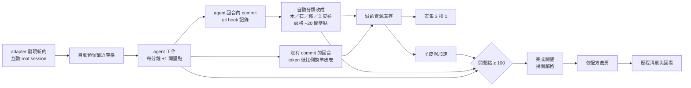

# herdr 開墾城鎮 mod 提案（v6.1）

> **狀態**：提案定稿前的版本，尚未實作。
> **歷程**：v1–v5.2 經過兩輪獨立審查與多輪使用者回饋；v6 改以 `(cityId, rootSessionId)` 遠征為核心。v6.1 納入第三輪三份審查（設計、技術、規格）與一次複核，並把收成改成 **git hook 自動收成**。被放棄的方案列在附錄 A。
> **事實依據**：
> - herdr-app 0.1.16：`~/.config/herdr-app/herdr.d.ts`、`gpui-kit.d.ts`、`AGENTS.md`
> - `hc` 實測
> - OMP：全域套件目錄 `@oh-my-pi/pi-coding-agent` 的 `package.json` 為 18.16.0；第二輪審查讀的是 `~/.bun/bin/omp` 內嵌的 18.22.0 程式碼。兩者行號可能不同，之後每個 spike 都要記錄實際執行的版本。
> - OMP bash 工具會把 `PI_SESSION_ID`、`PI_SESSION_FILE`、`PI_TOOL_CALL_ID` 注入每一次命令的環境變數（`src/tools/bash.ts:699-705`）
> - 本機 Codex、Claude Code 的 hook 與 transcript（第三輪技術審查唯讀查核）
> - 參考專案：herdr-traveler、world-of-codecraft

## 0. 一句話

**每個 agent session 都是一支遠征隊：工作時開墾土地，每次 commit 自動收成資源，再用資源蓋房；整座城就是可以回看的工作史。**

## 1. 決定紀錄

| 議題 | 決定 |
|---|---|
| 主題 | 寫實中世紀（世紀帝國式）；單位是工匠，不是冒險者；不做角色等級 |
| 一格代表 | 一組 `(cityId, rootSessionId, generation)` 遠征。同一個 root session 到不同城，各有一格；subagent 併入 root，不另開地 |
| 納入的 session | 只收**互動**的 top-level session。print、JSON、headless RPC、腳本呼叫的 omp 不建格 |
| MVP 驗證目標 | **收藏**：session、成果與投入累積成城鎮，可以回看；不做建築效果 |
| 自動選地 | 第一次看到新的遠征時，用 BFS 找最近的未佔用格；距離相同時依北、東、南、西的順序 |
| 收成 | **git hook 自動收成**：agent 在自己的回合裡做出的 commit（含 merge、amend、rebase）會自動分類、自動發資源。人工卡只處理無法判斷歸屬的例外 |
| 未 commit 的成果 | 不發建築資源 |
| 土地進度 | 三個來源加總，到 100 點完成開墾：工作時間每分鐘 +1；每次有效收成 +20；每張羊皮卷 +10。數值都是試玩參數 |
| 建築資源 | 木材、石材、鐵料只會由 commit 成果**直接發放**，不依 token、時間或 model；唯一的間接來源是市集轉換 |
| 羊皮卷 | 文件成果會產生羊皮卷；沒有 commit 的回合，token 也會依低比例自動換算成羊皮卷。羊皮卷不能直接當建材，可用來加速開墾，或到市集換建材 |
| 市集 | 城鎮中心自帶的功能，同一座城內任兩種資源都能互換，暫定 3 換 1 |
| 撤回／封存 | 從沒產出資源的格子可以手動處理：還沒開墾完的「撤回」並釋放座標；已開墾、未蓋房的「封存」，座標保留但不在地圖上顯示 |
| 行會 | provider 的真實額度若取得得到，就顯示成可調度的人力；遠征投入最多的 provider 決定建築的派系風格 |
| CLI | OMP 是參考 adapter；Codex、Claude Code 各需一個 adapter（S7）。手寫程式、手動 commit、沒有 adapter 的 shell 都不納入 |
| 城的身份 | 工作當下由 adapter 解析的 canonical git common dir。worktree 屬於原 repo 的城；submodule 自己是一座城；bare repo 不建城 |
| 格子 | 斜俯視 3/4 方格、四邊相鄰；邏輯座標與投影分開 |
| 平台 | 本機 macOS；只有單一 `appHome()` |
| 產值與用量 | API 等值放在次要統計，不當成就。token 只影響派系、造價與羊皮卷，不會直接產生木材、石材、鐵料 |

## 2. 定位與架構

### 2.1 和既有 layout 的差別

| | herdr-traveler | world-of-codecraft | 本提案 |
|---|---|---|---|
| 主體 | 側欄角色卡 | 固定的等角像素村莊 | 每個 session 自動遠征、隨 commit 成長的城鎮 |
| 強項 | agent 狀態、HP / SP | agent 即時活動演出 | 可以回看的 session、投入與成果史 |
| 累積 | 無 | 只有 4 筆事件紀錄 | 每個 session 一格，可以多次收成、持續開墾 |

本提案**不跟 world-of-codecraft 比 agent 的即時演出**。差別在於：城鎮是由真實的 session 和 commit 長出來的，而且可以回看。

### 2.2 架構

- **一個新的 mod**：不 clone 內建 mod，也不綁定特定 layout。城鎮地圖是一個 mod tab。
- **CLI adapter**：OMP extension 是參考實作。每個 adapter 輸出同一種活動格式（§6），內容包括 session 身份、這個 session 的來源角色（root、child、fork）、每段 visit 的 repo 身份、工作區間與用量。
- **收成 hook**：每座城可以選擇安裝一個 `post-commit` hook，在 commit 發生時記下 commit 和 agent 身份（§7）。
- **三層資料**：
  - adapter 狀態：由 CLI process 持續寫入，herdr 關閉時照常累積。
  - commit 紀錄：由 hook 寫入，一個 commit 一個檔案。
  - 城帳本：由 mod 寫入。journal 是唯一的提交點，其他資料都分頁、有大小上限（§13）。
- **繪製**：herdr 用 gpui-kit，由 JS 描述元件、Rust 用原生 GPU 繪製；沒有 HTML、CSS、WebGL，也沒有 3D API。立體感靠預先做好的靜態圖。

## 3. 核心循環



日常操作只有兩件事：**蓋房**和**用羊皮卷加速**。收成是自動的，只有例外才需要人工處理。

## 4. 地圖規則

| 項目 | 規則 |
|---|---|
| 座標 | 邏輯座標 `(x, y)` 是無限平面，只畫出看得到的部分；投影與邏輯分開 |
| 相鄰 | 只算上下左右 4 格 |
| 選地 | 中心 `(0,0)` 是城鎮中心。新遠征用 BFS 找最近的未佔用格，距離相同時依北、東、南、西排序；重新派遣也重新跑一次 BFS |
| 預留 | 預留格可以落在迷霧中，顯示遠征標記。預留不揭開鄰格，也不算正式領土。大量未完成的遠征會把後來者推到外圈，外圈先完成時，可見區域可以不相連；這是規則本身的結果，不需要另外限制 |
| 揭開 | 一格達到 100 點時，它自己和上下左右 4 格變成可見；原本就可見的格子不變 |
| 舊 repo | 開城時已有 HEAD 的 repo，中心用固定的「舊城區」圖，不回推歷史 |
| 點擊 | 以地面格子為準，屋頂只是裝飾 |
| 導覽 | 原生雙軸捲動，加上歷程清單可以直接跳到某一格（§12）；拖曳和縮放延後 |
| 非 git cwd | 不建城、不建格 |
| 城解析失敗 | cwd 不存在、git 執行失敗、common dir 無法正規化時，標成「未解析」並保留活動資料，不當成非 git。之後可以重試；若 adapter 在工作當下已經記錄 repo 身份，就以那份為準 |

## 5. 狀態模型

### 5.1 三層分開記錄

一格的狀態不是單一欄位，而是三個彼此獨立的維度：

| 維度 | 值 | 說明 |
|---|---|---|
| 土地階段 | 未開墾、已開墾、已建、已撤回、已封存 | 只能往前推進，不會倒退。總點數達 100（不論來自工作時間、收成或加速）時，自動從未開墾推進到已開墾並揭開鄰格。活動事件與收成**不能覆寫**已建、已撤回、已封存；已撤回與已封存那一代的點數凍結 |
| 活動狀態 | active、idle | root 或可歸戶的 child **只要有一個** active，就是 active；畫面上顯示為「探索中」，否則為「駐紮」 |
| 例外標記 | 有／無待確認 commit | 由 hook 紀錄與歸屬結果重新計算出來，不額外儲存 |

「預留」不是一個獨立狀態，而是土地階段為「未開墾」時的初始呈現。

### 5.2 手動處理

| 操作 | 條件 | 結果 |
|---|---|---|
| 撤回 | 未開墾，而且這一格從未收成過任何資源 | 釋放座標，封存這一代。已用掉的羊皮卷不退回 |
| 封存 | 已開墾、未蓋房，而且這一格從未收成過任何資源 | 座標保留、不再分配，地圖上不顯示，歷程清單仍查得到 |
| 重新派遣 | 已撤回或已封存 | 建立 `generation + 1`，重新跑 BFS 選地；工作點、加速點都從 0 開始，用量與活動也從當下重新起算 |

「這一格從未收成過任何資源」指的是沒有任何 commit 收成。研究產生的羊皮卷累積在整座城，不算這一格的產出。

### 5.3 不變量

- 同一座城的 `(cityId, rootSessionId)` 同一時間只會有一個現役的 generation；`/resume` 一律回到這一代。
- 已撤回或已封存的配對，在手動重新派遣之前，`/resume` 後的活動都不計入。
- **generation 的切點**：帳本保存每一代的啟用區間 `[activatedAt, deactivatedAt)`。interval、usage、commit 都**依事件發生的時間**決定屬於哪一代，而不是依 mod 處理當下的現役代；落在撤回或封存期間的事件不計入。跨過切點的 interval 在切點切開。
- 同一個 root session `/move` 到另一座城時，舊格變成駐紮，新城建立新格或恢復既有格。
- 工作時間取 root 與可歸戶 child 的 interval **聯集**，平行的 agent 不會重複計算分鐘數。
- 土地階段為已建時，任何活動、收成、resume 或 move 都不會改變它。

## 6. Session 遠征與 adapter

### 6.1 共同活動格式

```ts
interface HerdrActivity {
  schema: 1;
  cli: "omp" | "codex" | "claude";
  cliVersion: string;
  capabilities: { usage: boolean; parent: boolean; heartbeat: boolean; commitEnv: boolean };
  sessionId: string;
  role: "root" | "child" | "fork";       // 依 session 的來源判定，不看 UI
  parentSessionId?: string;              // child：執行中的上層；fork：來源
  interactive: boolean;                  // 只有 interactive 的 root 會建格
  writerEpoch: string;                   // 寫入者身份：pid + 啟動時間
  events: Array<{
    eventSeq: number;                    // 這個 writer epoch 內單調遞增
    kind: "visit_start" | "visit_end" | "interval_open" | "heartbeat" | "interval_close" | "usage" | "turn_end";
    at: number;
    visit?: { visitId: string; cwd: string; commonDir: string | null; checkout: string | null };
    usage?: Record<string, NormalizedUsage>;
    turnId?: string;                     // turn_end 事件帶上，供研究結算對應
  }>;
  updatedAt: number;
}

interface NormalizedUsage {
  inputNonCache: number;
  cacheRead: number;
  cacheWrite: number;
  output: number;
  costKnown: number;
  costUnknownEntries: number;
}
```

- **來源判定**：
  - OMP：同一個 process 會跑 root 與 task child（`task/executor.ts` 直接呼叫 `createAgentSession`），所以不能用 PID 判斷。
  - 判定規則：session 檔位於另一個 session 的同名資料夾內，就是 child；有 `parentSession`、但檔案在頂層的，是 fork。精確規則由 S6 驗證。
  - `hasUI` 只用來判斷是不是互動 session，不用來區分 root 與 child。
- **repo 身份在工作當下記錄**：visit 開始時，adapter 自己執行 `git rev-parse --path-format=absolute --git-common-dir` 和 `--show-toplevel`。之後就算 worktree 被刪掉，mod 重播時仍能歸到正確的城。
- **每次 cwd 改變都切一段新的 visit**，即使新舊 cwd 屬於同一座城。
- **用量正規化**由各 adapter 負責：
  - OMP：assistant message 和 `model_usage` 都要計入；改成增量累加，不每個 turn 重新掃描全部 entries。
  - Codex：input 本身已包含 cached input，要扣掉。
  - Claude Code：同一個 message ID 會出現在多筆紀錄，要依 message ID 去重。
  - 未知就標未知，不填 0。
- **fork**：會複製來源的歷史，所以它的用量起點要排除繼承來的部分；fork 若是互動的 top-level session，就當成新的 root。

### 6.2 ack、compact 與寫入者

- **每個寫入者一個檔案**：adapter 寫 `activity/<sessionId>/<writerEpoch>.json`。同一個 session 在另一個 terminal 被 resume 時，新的 process 用新的 `writerEpoch` 開新檔，舊的 writer 只能寫自己的檔，不會互相覆蓋。
- **ack 也按 epoch 分開**：mod 在帳本提交成功後寫 `acks/<sessionId>/<writerEpoch>.json`，內容是 `{ackedEventSeq, journalSeq}`。adapter 只讀自己 epoch 的 ack，並且只能刪掉 `eventSeq ≤ ackedEventSeq` 的事件。
- mod 合併所有 epoch 的事件：interval 取聯集，晚到的 heartbeat 只能延長**自己 epoch** 內尚未關閉的 interval；跟已保存區間重疊的部分不重算。
- **heartbeat**：OMP 用 `ctx.setInterval`，每 60 秒更新一次。沒有正常關閉的 interval，只算到最後一次寫入磁碟的 heartbeat。系統休眠或事件迴圈卡住時，heartbeat 不會準時觸發；規則只保證「不多算」。

### 6.3 `/new`、`/resume`、worktree 與 `/move`

- `/new`：新的 root session ID，在目前的城自動預留另一格。
- `/resume`：同一個 root session ID，在目前的城回到現役那一代；已撤回或已封存的仍然維持忽略。
- worktree：屬於同一座城，但每次切換 checkout 都會建立新的 visit。
- `/move`：下一次 `agent_start` 會用新的 cwd 建立 visit，用量起訖也跟著分開。
- 從 herdr 外啟動的互動 session 也會自動入城；手寫程式和沒有 adapter 的 shell 不納入。

## 7. 收成：git hook

### 7.1 hook 的內容

- 每座城可以選擇是否安裝（在城鎮畫面上操作），可以移除，**不使用全域 `core.hooksPath`**。
- 安裝三個 hook：`post-commit`（一般 commit、amend）、`post-merge`（成功自動合併）、`post-rewrite`（amend、rebase，從 stdin 取得舊 sha 對新 sha 的對照）。cherry-pick 等其他路徑由 S8 實測；沒有被任何 hook 觸發的提交，由下面的補捉流程處理。
- 安裝位置：repo 有自己的 `core.hooksPath` 時，裝在那個路徑；沒有時，裝在 common dir 的 `hooks/`，所有 worktree 共用。原本就有同名 hook 時，改名保留並由新 hook 先呼叫它；husky 這類工具，或 hooks 目錄已納入版本控制的情況，安裝前要先提示。
- hook 執行時寫入 `commits/<sha>.json`，內容包括：sha、觸發的 hook 種類、commonDir、toplevel、時間，以及環境變數 `PI_SESSION_ID`、`PI_TOOL_CALL_ID`、`CODEX_THREAD_ID`、`HC_TERMINAL_ID`。
- hook 必須在 50 ms 內結束、不連網、**一律以 exit 0 結束**。
- **補捉**：mod 定期讀取已知 checkout 的 `git reflog`。發生時間落在某個 agent 回合內、卻沒有任何 hook 紀錄的提交，列入例外卡，標記為「無來源證據」，不會自動發資源。

### 7.2 歸屬

| 情況 | 歸屬 |
|---|---|
| 有 `PI_SESSION_ID`（OMP 的 bash 會注入） | 歸到這個 session；若它是 child，再往上歸到 root |
| 有 `CODEX_THREAD_ID` 或 Claude Code 的對應變數 | 歸到對應的 session（S7 驗證） |
| 只有 `HC_TERMINAL_ID` | **不自動收成。** terminal ID 會被從該 terminal 啟動的 IDE、背景程序繼承，不能證明提交來源。依提交當下該 terminal 跑的互動 session 給出建議歸屬，放進例外卡由你確認 |
| 什麼都沒有（IDE、手動 commit） | 不收成，只記錄 |
| 沒有安裝 hook 的城 | **不自動收成。** 沒有 hook，就沒有任何資料能把某個 SHA 綁到產生它的那個動作上；只看 HEAD 在工具呼叫或回合前後的差異，無法排除你同時從 IDE 做的提交。adapter 仍會記錄每次工具呼叫前後新增的 SHA，但只當成**建議**：例外卡上預先選好建議的 session，由你按一下確認 |
| 依提交時間，這個 session 當時所屬的那一代已撤回或已封存，或當時沒有現役的一代 | 不收成 |

### 7.3 發資源

- mod 依 §8 的規則把每個路徑分類，**只跟第一個父節點比較**：
  - 一般 commit（含 merge）：`git diff-tree -r -M --name-status <sha>^1 <sha>`
  - 沒有父節點的初始 commit：`git diff-tree --root -r -M --name-status <sha>`
  - merge 從其他分支帶進來的變更也會列入，但這些內容若在原本的分支上已經被領過，城級去重會擋下。
- **單位**：同一代遠征的同一個路徑只算一次。同一個檔案 commit 20 次，仍然只算 1 單位。
- **城級去重**：每份成果的 claim key 是 `cityId + path + resultBlob`；刪除時用 `cityId + path + "deleted" + firstParentBlob`。同一份內容版本在整座城只發一次資源，跟遠征的起點無關。amend、rebase、cherry-pick、merge 帶進來的同內容版本不會重複發；revert 回到舊內容時，舊內容如果已經被領過，也不會再發。
- 只要有至少 1 個新單位，這一格就 +20 開墾點。
- 一次收成是 journal 的一筆 entry，引用的內容包括：commit 紀錄、claim、資源向量、開墾點、規則版本。operation ID 是 `harvest:<sha>`，所以重送不會重複入帳。

### 7.4 研究羊皮卷（自動）

- 一個回合從 `agent_start` 到 `agent_end`。回合結束時，先標成「待結算」，等這段時間內、這個 session 各個 checkout 上的所有提交都確定歸屬（自動歸屬、人工指定或忽略）之後才結算。
- 只要有任何 commit 歸到這個 session、時間又落在這個回合內，就算這個 commit 沒有產生新單位，這個回合也不算研究。沒有的話，這個回合 root 加 child 的 `inputNonCache + output` token 加進**這座城**的研究計量器。被人工忽略的提交，視為沒有歸屬。
- 計量器每滿 100,000 加 1 張羊皮卷，餘數保留；cache read／write 不算，用量未知的回合不計。
- 這個規則有一個已知的漏洞：先探索、下一回合才 commit 的工作，探索回合的 token 會被算成研究。因為換算比例很低，第一版接受，試玩時觀察。
- 結論可以選填，只用在回看，不影響換算。

### 7.5 人工例外卡

只會在以下情況出現：

- 沒有安裝 hook 的城：回合期間新增的所有提交，附上依工具呼叫前後 HEAD 差異算出的建議歸屬。
- 已安裝 hook 的城，補捉到沒有任何 hook 紀錄的提交。
- hook 紀錄裡的 session 無法對應到任何遠征。
- hook 紀錄只有 `HC_TERMINAL_ID`、沒有 agent 的 session 身份。

使用者可以選擇歸給哪一格，或忽略。選擇之後，資源的發放規則和自動收成完全相同。

### 7.6 蓋房、加速與市集

- **蓋房**：只列出庫存足以支付完整配方的建築；一次扣除配方需要的資源，並保存配方版本與實際支付的數量。已建的格子不能再蓋。
- **加速**：目標必須同時符合以下條件：是同一座城、是現役的那一代、沒有撤回或封存、仍佔著原本的座標、未滿 100 點，而且庫存足夠。只要有一項不符，就整筆不扣卷、不加點。目標用「遠征身份 + generation」指定，不用座標指定。每張羊皮卷加 10 點，超過 100 的部分不退還，也不會轉到其他格。
- **市集**：任兩種資源可以互換，暫定 3 換 1，每次都是一筆 CAS 操作。純文件 repo 可以用羊皮卷換成建材後蓋房。

## 8. 分類、資源與建築

### 8.1 試玩基準

以下數值只供試玩，不代表難度或品質；規則表會標上版本號，之後可以調整。

| 成果類型 | 判定（repo 相對路徑，大小寫不分） | 每單位 | 地面外觀 |
|---|---|---:|---|
| 測試 | `**/tests/**`、`**/__tests__/**`、`**/test_*`、`**/*_test.*`、`**/*.spec.*`、`**/*.test.*` | 石材 ×10 | 採石地 |
| 文件 | `**/*.md`、`**/*.rst`、`**/docs/**` | 羊皮卷 ×1 | 抄寫地 |
| 設定 | `**/*.json`、`**/*.yml`、`**/*.yaml`、`**/*.toml`、`**/.*` | 鐵料 ×5 | 礦地 |
| 程式 | 不屬於以上任何一類 | 木材 ×10 | 伐木地 |
| 研究 | 沒有 commit 的回合（§7.4） | 每 100,000 token 換 1 張羊皮卷 | 勘查地（這一格從未收成過時） |

| 建築 | 暫定配方 |
|---|---|
| 工坊 | 木材 ×30、鐵料 ×5 |
| 城牆 | 石材 ×40 |
| 圖書館 | 木材 ×20、石材 ×20、鐵料 ×5 |
| 倉庫 | 木材 ×20、石材 ×20、鐵料 ×10 |
| 民居 | 木材 ×20、石材 ×10 |

### 8.2 計算規則

- **分類優先序**：測試 > 文件 > 設定 > 程式。每個路徑只歸一類，例如 `tests/README.md` 算測試。
- **不計入**：預設排除 generated、vendor、依賴目錄與 lockfile；內容沒變的 rename 也不計。
- **二進位與大檔**：只看路徑和 blob ID，不讀檔案內容。
- **代表類型**：這一格的地面外觀，取第一次收成中單位數最多的類型；同分時依分類優先序。
- **規則版本**：分類規則、各類換算的數值、研究匯率、加速點數、收成點數、市集匯率、建築配方都有版本號；每次操作都會把當時使用的版本存進快照。

## 9. 行會、額度與派系風格

- **真實人力**：只顯示 provider 或 CLI 明確回報的額度、重置週期與更新時間。拿不到或資料過期時顯示「未知」。
- **不互相換算**：累計 token、API 等值與剩餘額度是不同的數字，不能用其中一個推算另一個；mod 也不會因為額度而擋住派工。
- **投資**：每一格只計算它自己 visit 範圍內的 provider 用量，包含可以歸到它的 child。費用全部已知時，用 API 等值比較；有任何未知時，改用不含 cache 的 input 加 output token 比較。
- **派系風格**：累積投資最多的 provider 決定建築的派系風格。同分時取 root session 的 provider；完全未知時用「無派系」。
- **不影響數值**：派系不會改變開墾點、資源、匯率或建築配方。

## 10. 開墾點與造價

- **總點數** = `floor(自然工作毫秒 / 60_000) + 收成點數 + 加速點數`。三者分開保存。
- **自然工作毫秒**：由合併後的 interval 計算，跟 interval 一起保存。
- **節奏目標**：一般開發 repo 在 1–2 個工作日內出現第一棟建築，而且不需要刻意拉長 session 或多寫文件。試玩如果達不到，就調整 100 點的門檻、收成 +20、羊皮卷 +10 這三個數字。
- **造價**：顯示這一格的已知 API 等值、未知部分、工作時間，以及已用掉的羊皮卷；這些都不換算成成果價值。
- **本月統計**：以收成的月份計算（時區 Asia/Taipei），顯示「本月已收成 API 等值 ÷ 月費」。沒有填月費或有未知成本時，要標明限制。

## 11. 資源

| 情況 | 變化 |
|---|---|
| commit 收成 | 依新單位的分類，加木材、石材、鐵料或羊皮卷；該格 +20 開墾點 |
| 沒有 commit 的回合 | 研究計量器累加，滿 100,000 加 1 張羊皮卷 |
| 蓋房 | 依配方扣除資源 |
| 加速 | 每張羊皮卷 +10 開墾點 |
| 市集 | 3 換 1 |
| 手動 commit、未 commit 的成果、已撤回或封存的那一代 | 0 |
| 重複的 claim key 或 operation ID | 不重複收支 |

**限制**

- 木材、石材、鐵料只會由 commit 成果直接發放；市集轉換是唯一的間接來源。統計上，「直接發放」和「市集轉入」分開記錄。
- 研究羊皮卷會鼓勵燒 token，這個誘因要靠低換算比例壓住，試玩時觀察。
- 沒有被動產出，也沒有庫存上限。
- MVP 不做機率掉落。

## 12. 回看與歷程清單

- **點格子**：可以看到 CLI、session、generation、每段 visit 與它所在的 checkout、工作區間、三種開墾點、每次收成的 commit、成果路徑與 claim、資源向量、規則版本、provider 投資、建築與實際支付的資源。
- **歷程清單**：可以依日期、城、session、commit 訊息、成果路徑搜尋，點選後跳到對應的格子。已撤回和已封存的遠征，從這份清單查得到。
- 這是本提案和其他 layout 的主要差別，必須在 MVP 裡做到。

## 13. 存檔

### 13.1 journal 與衍生資料

herdr 一次只能讀 1 MiB（`herdr.d.ts:27-29`），所以**每個檔案都必須有固定的大小上限**。不會無限增長的檔案只有 head；其餘全部分頁。

- **head**：`appHome()/data/<mod>/cities/<cityId-hash>/head.json`，大小固定，只放 `schemaVersion`、`rulesVersion`、`cityId`、目前的 journal 分段編號、最新 checkpoint 編號。
- **journal（唯一的提交點）**：`journal/<segment>.json`，每段上限 256 KiB。每一筆操作（收成、加速、蓋房、市集、撤回、封存、重新派遣、活動合併）以一筆 entry 附加上去，用 `writeTextFile(path, text, expected)` 對該段做 CAS。**entry 出現在 journal 裡，才代表操作完成。**
- **換段**：分段放不下下一筆 entry 時，寫入者先用 CAS 在舊段附加**封段標記**（最後的 `journalSeq` 和下一段編號）；封段成功之後才建立下一段（`expected = null`），再用 CAS 更新 head。任何寫入者讀到封段標記，就必須改寫到下一段，並從封段後的狀態重新檢查前提；下一段還不存在時，由它自己建立。因為封段本身是對舊段的 CAS，同時想附加到舊段的其他寫入者一定會 CAS 失敗而重讀，不會出現兩段同時被寫入的情況。
- **內容檔**：路徑清單、合併後的 interval 這類大的內容，存成以內容雜湊命名的 `blobs/<hash>.json`，寫入 journal 之前先寫好。序列化後超過 256 KiB 的內容要切塊：每塊各自是一個 blob，另外寫一份 manifest blob 依序列出各塊的雜湊；manifest 本身超過上限時，再用同樣方式分層。journal entry 只引用最上層的雜湊。沒有被 journal 引用的內容檔不算任何操作，下次重試時直接沿用，或清理掉。
- **衍生資料**：以下這些都可以從 checkpoint 加上之後的 journal 重新算出來，每個檔案上限 256 KiB：
  - 座標分塊：`chunks/<cx>_<cy>.json`，每塊 32×32 格
  - 遠征、claim、operation ID 索引：用**可延長前綴的雜湊分頁**。查詢從前 2 碼的頁面開始；頁面寫滿時拆成多個前綴更長的子頁面，原頁面改成只記錄「已拆分」的小標記，查詢就往下一層找。每一頁都有上限，層數隨資料量對數增長。
  - 資源庫存與研究計量器
- **checkpoint**：定期把衍生資料寫成 `checkpoints/<journalSeq>/`，再用 CAS 更新 head。讀取時：讀 head → 讀 checkpoint → 重播 checkpoint 之後的 journal。
- **提交流程**：先寫內容檔；讀取到 journal 最後一筆為止的狀態，重新檢查前提（庫存是否足夠、claim 是否已存在、operation ID 是否已存在、目標是否仍是現役的一代）；然後用 CAS 附加 entry。CAS 失敗就重讀、重新檢查、再試。
- **兩個城鎮畫面同時操作**時，都經由同一段 journal 的 CAS 決定誰先。
- **ack**：journal 提交成功之後，才寫 adapter 的 ack 檔。

### 13.2 欄位

| 檔案 | 欄位 | 大小上限 |
|---|---|---|
| head | `schemaVersion`、`rulesVersion`、`cityId`、journal 分段編號、checkpoint 編號 | 固定 |
| journal entry | `journalSeq`、operation ID、種類、目標遠征與 generation、引用的內容檔雜湊值、收支、規則版本、時間 | 每段 256 KiB |
| 座標分塊 | 每一格：座標、`rootSessionId`、generation、土地階段、三種點數、代表類型、建築、是否曾收成、派系 | 32×32 格 |
| visit 內容檔 | visit ID、session、generation、cwd、commonDir、checkout、開始與結束時間、合併後 interval、用量起訖 | 每塊 256 KiB，超過時切塊加 manifest |
| 收成內容檔 | sha、hook 種類、歸屬依據、路徑與 claim、資源向量、新增點數 | 每塊 256 KiB，超過時切塊加 manifest |
| claim／operation／遠征索引 | key → journalSeq 或遠征資料 | 每頁 256 KiB，寫滿時拆成前綴更長的子頁 |
| 庫存與計量器 | 四種資源、研究計量器、直接發放與市集轉入的統計 | 固定 |
| 額度快照 | provider、原始回報、重置週期、擷取時間 | 每個 provider 一份 |

## 14. 美術（mock 主題包）

| 素材 | 數量 |
|---|---|
| 地形：草地、迷霧、預留標記 | 3 |
| 城鎮中心、舊城區 | 2 |
| 地面：伐木地、採石地、抄寫地、礦地、勘查地 | 5 |
| 建築：5 種 × 4 套派系風格（Anthropic、OpenAI、Google、無派系） | 20 |
| 資源圖示：木材、石材、鐵料、羊皮卷 | 4 |
| 狀態標記：探索中、駐紮、待確認、已封存 | 4 |
| 市集 | 1 |
| **合計** | **約 39 張** |

- 先用 OMP 和 mock 圖完成一條縱切流程，驗證收藏價值成立，再補齊全部派系美術。

## 15. 先行技術驗證

建議順序：**S6 → S8 → S3 → S4**；S5、S7 可以平行進行。

| # | 驗證什麼 | 最小做法 | 通過條件 |
|---|---|---|---|
| S1 | terminal 與 session 對應 | 文字面板 + OMP extension | **✅ 2026-11-19 通過**（§15.1） |
| S2 | OMP 用量紀錄 | extension 摘要與 session 檔對帳 | **✅ 2026-11-19 通過** |
| S2b | 用量效能 | 10k 與 100k 筆 entries 的 session | 增量累加與全量重算結果相同；記錄每個 turn 的耗時與記憶體配置 |
| S3 | 收成、claim、journal 與 CAS | 測試城：1 萬支遠征（含撤回與封存）、10 萬筆操作、一個改了 2 萬個路徑的 commit | head 大小固定，每個檔案都低於 256 KiB；索引頁面寫滿時正確拆分、查得到；大 commit 的內容檔切塊後可完整讀回；城級去重：兩支遠征從不同起點看到同一份內容，只發一次；兩個畫面用不同 operation ID 同時搶同一份庫存，只成功一次；內容檔已寫、journal 還沒附加時中斷，重啟後該操作視為未完成、可以重試；換段時，一個寫入者封段、另一個同時附加到舊段：後者 CAS 失敗、改寫到下一段並重新檢查庫存，不會重複支出 |
| S4 | 地圖 | 300 格與高矮不同的 mock 建築 | BFS 結果穩定、圖片不攔錯點擊、延遲符合開工前訂的門檻 |
| S5 | provider 額度 | 讀一次原始額度資訊 | 保存原始值與擷取時間；拿不到時顯示未知 |
| S6 | adapter 協定 | OMP | 以下情境都要通過：互動 TUI 的 root、print 模式的 root、headless RPC、task child、root fork、兩個 terminal resume 同一個 session，逐一核對建了幾格、各 epoch 的檔案有沒有互相覆蓋；ack 延遲以及 compact 前後中斷時，重播結果相同；herdr 關閉期間依序在 A、臨時 worktree、B 工作，並刪掉臨時 worktree 後才重播，投入仍歸到正確的城；heartbeat 只算到最後一次寫入 |
| S7 | Codex／Claude adapter | 各做一個最小 adapter | 純文字回合、工具回合、resume、child、abort 都要通過；Claude 依 message ID 去重；Codex 正確處理 cached input；確認 bash 的環境變數裡有沒有可用的 session ID |
| S8 | git hook | 測試 repo | 安裝時會串接既有的 hook、尊重 `core.hooksPath`、遇到 husky 會提示；OMP bash 執行的 commit 帶有 `PI_SESSION_ID`；OMP 自己的 commit 工具執行時，hook 會不會跑、環境變數在不在；逐一實測初始 commit、commit、amend、rebase、cherry-pick、`merge --no-ff`、衝突解決後的 merge commit，各自觸發哪個 hook、`diff-tree` 指令能否正確列出路徑；沒有觸發的提交能被 reflog 補捉；hook 在 50 ms 內完成；同一次 agent 工具呼叫還沒結束時從 IDE 插入一個提交，hook 只把帶有 agent 環境變數的那個 SHA 歸給 agent；沒裝 hook 時不會自動發任何資源 |

### 15.1 S1、S2 結果（2026-11-19）

**程式**：`omp-extension/herdr-reclaim.ts`、`mod/herdr-reclaim/`（文字面板）、`spikes/s2-reconcile.ts`、`tools/install.sh`

**測試環境**：`/tmp/herdr-reclaim-sandbox`（git）。主 session 用 Sonnet，subagent 走 Databricks。

| 檢查 | 結果 | 證據 |
|---|---|---|
| 帶 `folder` 開出 omp | ✅ | session 的 cwd 是 `/tmp/herdr-reclaim-sandbox`，space 自己的 `folder` 指向別的 repo |
| 綁定唯一 terminal 與 session | ✅ | 工單 `omwn0ptq4` → t50、`omwn0rbla` → t51；pane 對照一致 |
| tab 改名 | ✅ | 對應檔不變 |
| `/new` 不串帳 | ✅ | `reason: session_switch:new`，新 session ID；原 session 用量不變 |
| `/resume` | ✅ | `reason: session_switch:resume`，換回原 ID |
| `/move` | ✅ | 不觸發事件；下一次 `agent_start` 帶新 cwd；用 ID 找得到搬走的檔案 |
| subagent 用量 | ✅ | subagent 也載入 extension；依 `rootSessionId` 歸到 root |
| 對帳 | ✅ | 三個 session 家族逐一 provider 比對都一致，包含 Databricks 的未知價格 |
| 兩個畫面同時寫 | ✅（修正後） | 改成序列化並 CAS 重試 |

**S1、S2 沒有驗證到的部分**：v6.1 的 adapter 協定（S6）、git hook（S8）、Codex 與 Claude（S7）。S1 的面板只是技術 spike，資料模型和 v6.1 不同。

### 15.2 循序驗證：S8、S5（2026-11-19）

**S8 尚未通過。** 可重跑：`sh spikes/s8/hook-matrix.sh`。測試使用暫存 repo，隔離全域 Git 設定，結束自動清除；沒有安裝到使用者的城。

| 操作（Apple Git 2.50.1） | 實際 hook |
|---|---|
| 初始／一般 commit、cherry-pick、revert、解衝突後 commit | `post-commit` |
| amend | `post-commit`、`post-rewrite amend` |
| rebase（本次 merge backend、一筆重播） | `post-commit`、`post-rewrite rebase` |
| `merge --no-ff` 自動完成 | `post-merge` |
| rename、empty commit | `post-commit`；diff 分別為 `R100`、空清單 |

- 第一父節點 diff、初始 commit `--root`、rewrite 的舊／新 SHA 對照均有斷言通過。amend／rebase 會重複通知，不能按 hook 次數發資源。
- 測試安裝器尊重 repo-local `core.hooksPath`；既有 hook 收到原參數與 rewrite stdin，即使回傳 7，記錄器仍回傳 0；Husky／已追蹤的 hook 路徑會拒絕直接安裝。這是 spike，不是正式安裝器。
- OMP **bash** 路徑的 hook 有 `PI_SESSION_ID`、`PI_TOOL_CALL_ID`。同一次 bash 工具呼叫內，模擬 IDE 提交只保留 `HC_TERMINAL_ID`、移除 session 變數，該 SHA 沒有 agent 身分；不能用 terminal ID 自動歸戶。
- OMP **eval `commit` namespace** 的隔離實測：`post-commit` 有執行，但 `PI_SESSION_ID` 與 `PI_TOOL_CALL_ID` 都是空值，只有 `HC_TERMINAL_ID=t58`。**因此目前主要提交工具不能自動收成**；依 §7.2 必須進例外卡，不能用相鄰工具呼叫推定來源。測試提交 `10a36617b5395ca0a8ad819ed68e532d70e4a31b` 位於一次性 repo，並非本專案歷史。
- 關閉 hook 的提交可由 reflog 找到，但沒有來源證據。正式帳本尚未接線，所以「不發資源」目前僅是規格，沒有端到端驗證。
- Python spike 記錄器 50 次：中位數 **61.27 ms**、p95 **64.34 ms**、最大 **66.01 ms**，未達 50 ms。這只量測新記錄器；既有 hook 的執行時間不受本 mod 控制，§7.1 的總耗時保證仍須釐清。

**S5 CLI spike 通過；正式城鎮 UI 尚未接線。** 指令：`omp usage --json --redact --no-extensions`，`generatedAt=1795082919780`。原始數值與擷取時間保存在 `spikes/s5/observed.json`（移除帳號識別欄位）；執行 `python3 spikes/s5/show.py`，已觀察到 Databricks 顯示「未知（沒有 provider report）」、無額度的 Codex 帳號另列未知，不和已知帳號合併。

| provider／週期 | used / limit / remaining | fetchedAt | resetsAt |
|---|---|---|---|
| openai-codex／7d | 12 / 100 / 88 | 1795082918586 | 1795420897000 |
| anthropic／5h | 16 / 100 / 84 | 1795082919165 | 1795098000040 |
| anthropic／7d | 81 / 100 / 19 | 1795082919165 | 1795212000040 |

另有一個 Codex account 出現在 `accountsWithoutUsage`；Databricks 沒有出現在 reports。這兩種情況都不能解讀成剩餘 0 或 100，也不能據此斷定前次 fallback 是額度耗盡。

### 15.3 S3：中斷原型的獨立執行驗證（2026-11-19）

**未通過，不可直接移入正式 mod。** 本輪沒有再啟動 subagent；對前一輪留下的 `spikes/s3/lib/` 加上獨立斷言，執行 `bun spikes/s3/verify.ts`，結果 **5 pass / 5 fail**，exit 1。保留失敗案例作為原型修復的驗收，不降低標準。

| 檢查 | 結果 |
|---|---|
| 城級 claim、operation ID 去重 | 通過：兩支遠征看到同一 claim，只發一次 |
| 兩個 writer 搶同一庫存 | 通過：一成功、一個重讀後 `insufficient_wood` |
| 內容已寫、journal 未提交即中斷 | 通過：重啟不入帳；重試沿用 blob、只入帳一次 |
| 2 萬路徑內容切塊回讀 | 失敗：原始 2,428,891 bytes，讀回的是 369-byte manifest |
| 前綴頁滿拆分與查詢 | 通過：1 萬 key，72 次拆分、1,356 頁；每筆可查回 |
| 封段與舊 writer 競態 | 通過：舊 snapshot CAS 失敗，重新檢查庫存後拒絕支出 |
| 封段仍須遵守容量上限 | 失敗：1,024-byte 測試上限產生 1,039-byte 段 |
| 收成點數 +20 | 失敗：原型仍加 100 |
| 重新派遣後拒絕舊 generation 的收成 | 失敗：gen 1 的收成被套入 gen 2 |
| 1 萬遠征／10 萬操作／checkpoint | 重播一致，但容量失敗：4 個 journal 段超過 256 KiB |

容量執行約 **103.57 秒**，39 段、38 個封段標記、journal 共 9,963,387 bytes，最大段 **262,161 bytes**（上限 262,144）；569 個檔案。checkpoint 最大檔案 141,313 bytes；head 由 95 變成 100 bytes（固定欄位不等於固定字節數）。所有暫存資料於驗證後清除。

定位：`content.ts` 把 manifest 再交給 `put()`，最後寫成 `.l`，`get()` 便當成原始內容回傳；`ledger.ts` 換段前沒有預留 seal 的序列化空間；`applyEntry()` 仍使用 +100；`precheck()` 沒有核對收成的 generation。這些是**未完成 spike 的實作缺陷**，不能據此宣稱 journal/CAS 方案不可行，也不能拿先前「零 finding」的文件複核當作執行通過。

### 15.4 S6／S2b：Runtime 能力與基線差距（2026-11-19）

**部分能力已實測，S6、S2b 尚未通過。** `python3 spikes/s6/probe.py` 啟動隔離 OMP 18.22.0；不送 prompt、不呼叫模型、不開 task child，也不載入使用者 extension。

| 實際模式 | `ctx.mode` | `ctx.hasUI` | `ctx.agent` |
|---|---|---|---|
| 真正 PTY 的互動 TUI | `tui` | true | `kind=main, depth=0` |
| print | `print` | false | `kind=main, depth=0` |
| headless RPC（`--no-ui`） | `rpc` | false | `kind=main, depth=0` |

三者的 `ctx.setInterval` 在 110 ms 觀察窗內都執行 5 次（測試間隔 20 ms），然後清除並正常 shutdown。這證明 timer API 可用，不代表 60 秒 heartbeat 的崩潰結算已通過。print／RPC 的隔離環境須指定模型與無效測試 key 才能完成啟動；無 prompt，未送出推論請求。

`bun spikes/s6/verify-baseline.ts` 直接呼叫現有 S1/S2 extension 的事件 handler，得到兩項契約失敗：

- top-level fork 被歸入來源 root，而非自己的新 root。
- 同 session 兩次 writer 更新只留下最後 snapshot（input 7 被 input 3 覆蓋），沒有 per-epoch activity 目錄。此為事件層 fixture，不冒充兩個真實 terminal 的競態驗收。

基線也沒有 `writerEpoch`／events／ack／compact／visit／heartbeat 寫入協定。因此雙 terminal resume、ack 延遲及 compact 中斷、離線 A→worktree→B 後刪 worktree、崩潰後 heartbeat 截止等條件**尚無可測的 v6.1 adapter 實作**；不能以 S1/S2 通過替代。依本輪「不開 subagent」限制，child live 情境未重跑。

S2b 只量到現有全量掃描：10k entries 8.04 ms、heap delta 327,680 bytes；100k entries 5.38 ms、heap delta 0。各一個樣本，包含寫檔；有 JIT／GC 影響，不能拿兩點比較成長率，heap delta 不是配置量。尚無增量實作可比對。

另以隔離 `HERDR_APP_HOME` 執行 `herdr-app check spikes/s6/fs-probe`：成功在 appHome 外的同層暫存路徑寫入 `first`，證明 mod 可以寫 adapter 目錄。**check 提早結束，沒有跑完後續 async CAS 鏈**；`check passed` 不能當成整條非同步驗證完成。

### 15.5 S7：外部 CLI 唯讀能力盤點（2026-11-19）

**尚未通過完整 adapter 驗收。** 沒有啟動額外 agent；只讀既有 hook、CLI help 和去識別的 transcript 結構，未修改 `~/.codex/**`／`~/.claude/**`。

- 安裝版本：Codex 0.156.1、Claude Code 2.1.317。
- Codex 的既有 herdr hook 只處理 SessionStart，讀 stdin 的 `session_id`／`transcript_path`，並檢查繼承的 `CODEX_THREAD_ID`。這不是本輪 bash 注入的實測證據。
- Claude 的既有 hook 只處理 SessionStart，遇到 `agent_id` 直接跳過；沒有把 session ID 注入後續 bash。不能直接把該 hook 當成完整 adapter。
- `spikes/s7/usage_probe.py` 是**離線用量探針**，不是完整生命週期 adapter。Codex 樣本 89 筆 `token_usage_record`，以 response ID 歸一後與最後一筆 `token_count.total_token_usage` 對帳一致：non-cache input 136,613、cache read 7,918,848、output 24,776。不能把兩種記錄再相加。
- Claude 樣本混合 2.1.83／2.1.296／2.1.308：675 筆 assistant usage 只有 377 個 message ID，其中有相同 usage 重複三次的實例。以 message ID 保留最新值；126 個 ID 欄位不完整，明確標 unknown，不補零。已知部分合計 non-cache input 500、cache read 134,282,986、cache write 3,901,078、output 306,507；不是完整 session 總量。
- 另一份 2.1.317 紀錄沒有 assistant usage，只有請求／cost-state 等事件；沒有可用回應用量不代表零消耗。
- 純文字／工具回合、resume、child、abort 的 **live adapter** 情境，以及兩個 CLI 的 bash session 環境變數，仍未驗證；本輪不把讀檔成功當作完整 S7 通過。

## 16. MVP 範圍

**包含**

- OMP adapter、共同的活動格式；S7 通過的 Codex／Claude 最小 adapter
- git hook 自動收成（post-commit、post-merge、post-rewrite）、reflog 補捉、未裝 hook 時的建議卡、人工例外卡
- 自動選地、resume、move、撤回、封存、重新派遣
- 開墾點（工作時間、收成、加速）、研究羊皮卷、市集、建築、派系
- 歷程清單與回看、journal 帳本、CAS、claim 去重

**排除**

- 非互動 session、手寫程式、手動 commit、未 commit 的成果、沒有 adapter 的 shell、bare repo
- 建築效果、隨機掉落、手動選路、地形、道路、熱點
- issue／MR、LLM 分類器、估算 provider 剩餘額度
- 等角或六角投影、拖曳與縮放、遠端、Windows、多 client

## 17. 驗收

以下都在隔離的測試城進行，用固定時間戳的事件重播取代真實等待。

### 17.1 功能驗收

1. **身份、BFS 與城**
   - 空城依序加入五個 root：分別落在北、東、南、西，以及 `(0,-2)`；同一批事件重播兩次，不會多出格子。
   - `/resume` 回到同一格；`/new` 開新格。
   - 同一個 repo 的不同 worktree 屬於同一座城，但 visit 分開。
   - 從 A 移到 B 再移回 A，會恢復原本 A 的那一格。
   - 非 git 的 cwd 不建城；城解析失敗時顯示「未解析」，活動資料不丟失。
2. **來源與聯集**
   - print、headless 的 root 不建格；task child 不建格；互動的 fork 建新格，而且不包含繼承來的用量。
   - root 與兩個 child 都在 `[0, 300000)`：5 點。root 閒置時，child 新增一段不重疊的 60000 ms：再 +1 點。
   - 先保存 90000 ms 並 compact，再加一段不重疊的 30000 ms：共 2 點。之後補進一段已被涵蓋的 child interval，點數不變。
   - 最後一次 heartbeat 在 60000 ms、process 在 119000 ms 中止：只算到 60000 ms。
3. **離線重播與寫入者**
   - herdr 關閉期間依序在 A、臨時 worktree、B 工作，刪掉 worktree 後才重播：各段投入歸到正確的城。
   - 兩個 terminal resume 同一個 session：兩個 epoch 各寫自己的檔案，事件不會被覆蓋；舊 writer 晚到的 heartbeat 不會延長已關閉的 interval。
   - ack 延遲或 compact 前中斷後重播：時間和用量都相同。
4. **commit 收成**
   - OMP bash 執行的 commit，改了 1 個程式檔、2 個測試檔、1 份文件：得到木材 10、石材 20、羊皮卷 1，該格 +20 點。
   - 同一代遠征把同一個檔案 commit 三次：只算 1 單位。
   - 用 IDE 手動 commit：不收成。
   - 已裝 hook 的城：agent 執行 `git commit … && npm test`，先產生 A；測試還在跑時，你從 IDE 提交 B。A 帶有 `PI_SESSION_ID`，自動歸給 agent；B 沒有，不收成。
   - 沒裝 hook 的城：不論是工具呼叫之間、工具呼叫進行中，或 agent 的 commit 失敗之後，你從 IDE 做的提交都不會自動發資源；所有提交只出現在例外卡上，附建議歸屬，由你確認。
   - 已裝 hook 的城：從 herdr terminal 啟動的程式提交，只帶有 `HC_TERMINAL_ID`、沒有 agent 的 session 身份：不自動收成，進例外卡並附建議歸屬。
   - 新 repo 的第一個 commit 也能正常收成。
   - 城級去重：S1 在內容 A 時開始、S2 在內容 B 時開始，兩者都 commit 出內容 C，只有先到的那次發資源。
   - amend 成相同內容：不重複發；revert 回到已被領過的內容：不發。
   - merge：只跟第一個父節點比較；其他分支帶進來、已經在該分支被領過的內容不重複發；從未被領過的則照常發。`merge --no-ff` 經由 post-merge 也能收成。
   - 舊的一代已撤回，忽略期間產生 commit，之後重新派遣，mod 才讀到這個 commit：依提交時間歸到舊的一代，不收成，也不會補進新的一代。
   - 沒裝 hook 的城：例外卡上，依工具呼叫前後 HEAD 差異預先選好建議的 session；你確認之後才發資源，規則和自動收成相同。
5. **研究、羊皮卷與市集**
   - 同城的 S1 有 60000 個合格 token（沒有 commit 的回合）：0 張、計量器 60000；S2 再有 40000：1 張、計量器歸 0。另一座城的計量器不受影響。
   - cache 的 500000 token 不影響上述結果；有 commit 的回合不累加，即使那個 commit 沒有產生新單位；用量未知的回合不累加。
   - 回合結束時，這段時間內還有待確認的 commit：研究暫不結算；這個 commit 後來被歸給這個 session，這個回合就不發研究羊皮卷；被忽略的話，才補發研究羊皮卷。
   - 市集用 3 張羊皮卷換 1 份木材；庫存不足時，整筆不執行。
6. **加速與資格**
   - 5 點的格子用 3 張羊皮卷：自然 5 加上加速 30，庫存歸 0。95 點的格子用 1 張：完成開墾、揭開鄰格，超出的點數不退。80 點的格子收成 +20：自動變成已開墾。
   - 目標是已撤回、已封存、舊 generation、別的城，或已滿 100 點時：不扣卷。
   - 兩個畫面：其中一個撤回某格、這個座標被其他遠征佔走後，另一個畫面才確認原本的加速：不扣卷、也不會改到新的遠征。
7. **撤回、封存與蓋房**
   - 從未收成的未開墾格可以撤回，座標被釋放；之後新的 S2 會取得這個座標。原本的 S1 重新派遣時，generation 加 1、點數歸零、重新跑 BFS。
   - 已開墾、未收成、未蓋房的格子可以封存：從地圖隱藏，歷程清單查得到，座標不釋放。
   - 有收成過的格子不能撤回或封存。
   - 庫存只夠一種配方時，只列出那一種；已建的格子不能再蓋。
   - 已建的格子 resume 後又有新的 commit：建築保留，收成照常發生。
8. **原子性與回看**
   - 收成、加速、蓋房、市集，分別在「內容檔已寫、journal 尚未附加」和「journal 已附加、還沒回覆」兩個時間點中斷並重啟：前者視為未完成、可以重試，後者視為已完成、重送不會重複。
   - 1 萬支遠征、10 萬筆操作、一個改了 2 萬個路徑的 commit 時，head 大小固定，每個檔案都低於 256 KiB，歷程清單仍可以搜尋並跳到對應的格子。

### 17.2 試玩

- **期間**：連續 5 個工作日；其中至少一天照平常的步調，開十幾個 session。要涵蓋 `/new`、`/resume`、`/move`、worktree、subagent、研究，以及連續短修正。
- **記錄**：
  - 首次開墾、首次建築分別花了幾個工作日或幾個 session
  - 建材已經夠、卻沒有開墾完成的土地可蓋的格子數
  - 每天花在處理例外、撤回、封存、加速、蓋房的總時間，以及積壓數量
  - 自動選地是否符合預期
  - 是否為了資源或羊皮卷，改變 commit 習慣、model 或 session 長度
- **建議門檻**（開工前固定）：
  - 一般開發 repo 在 1–2 個工作日內出現第一棟建築
  - 每天的整理時間 ≤ 3 分鐘
  - 所有成果都能追溯，且沒有重複領取
  - 能從歷程清單找回前幾天的一項成果
  - 至少 3 天主動回來看，並且願意下一週繼續用
- **判讀**：功能都通過、但試玩不通過時，先改設計，不要繼續擴充。

## 18. 後續候選（MVP 驗證後再排序）

- **地形與路線**：加入地形差異後，讓使用者手動選擇遠征方向。
- **特殊快轉道具**：每 1M 個研究 token 給一次；如果用機率，要保存 seed、roll 次數與保底計數，確保可以重現。
- **書記官入口**、**LLM 分類器**
- **熱點與道路**
- **跨城貿易**（王國地圖）
- **更多 adapter 與額度來源**
- **其他**：issue／MR、等角或六角投影、動畫

## 19. 審查紀錄

| 輪次 | 判定 | 主要問題 | 處理 |
|---|---|---|---|
| R1 設計 | 值得做小型縱切 | 虛構稅收、把檔案存在當成品質、研究沒有成果 | 改成開墾模式、砍掉稅收 |
| R1 技術／規格 | blocker／不完整 | session 對應、大檔、平台、身份、存檔 | extension、session ID、用量摘要、CAS |
| R2 設計／技術／規格 | 只能驗證收藏／incorrect | 成果歸屬、`/move`、回看、生命週期 | 成果快照、狀態機、spike、驗收 |
| v5.1–v5.2 | — | 資源類型、session 與 worktree 歸屬 | 多類資源、拆分身份 |
| v6 使用者 | — | session 遠征、事件驅動投入、羊皮卷加速、手寫排除 | 核心改版 |
| R3 規格 | incorrect（0.97） | 去重 key 受起點影響；狀態不互斥；研究結算範圍不清；加速可能套到已撤回的格 | §7.3 城級 claim；§5 三層狀態；§7.4 以回合為單位；§7.6 加速資格 |
| R3 設計 | incorrect（0.93） | 已開墾的無成果格無法處理；短 session 開不完土地；整理負擔；找不到過去的成果；純文件 repo 蓋不了房 | §5.2 封存；commit 收成 +20 點；自動收成；§12 歷程清單；市集 |
| R3 技術 | incorrect（0.97） | 用 `hasUI` 判定 root；單一帳本超過 1 MiB；離線時 repo 身份遺失；ack 與寫入者規則不完整；用量正規化；版本號 | §6.1 來源判定與工作當下記錄 repo 身份；§6.2 ack 與寫入者；§13 journal；§15 S2b、S6–S8 |
| v6.1 使用者 | — | commit 收成用 git hook；研究自動累積；加市集；排除非互動 session | §7、§11、§1 |
| v6.1 複核 | 2 個 P1、7 個 P2 | 主檔仍會無限增長；分片存在被當成已提交；merge 走 post-merge 而漏收；merge 的比較基準；沒裝 hook 時把手動 commit 誤歸給 agent；兩個寫入者互相覆蓋；研究在 commit 待確認時先結算；commit 沒有依時間歸 generation；土地階段規則矛盾；市集與建材來源矛盾 | §13 改為 journal 加衍生資料；§7.1 三個 hook 加 reflog 補捉；§7.3 只跟第一個父節點比較；§7.2 沒裝 hook 時不自動收成；§6.2 每個 epoch 一個檔案；§7.4 待結算；§5.3 依時間決定 generation；§5.1 只能往前推進；§11 措辭 |
| v6.1 第二、三次複核 | 2 個 P1、3 個 P2 | journal 換段時兩個寫入者可能各寫一段；雜湊桶與大型內容檔仍會超過 1 MiB；HEAD 差異（即使縮到單次工具呼叫）仍無法證明提交來源；初始 commit 的指令無效 | §13.1 先 CAS 封段再換段；可延長前綴分頁與內容切塊；§7.2 沒裝 hook 時只給建議卡；§7.3 初始 commit 改用 `--root` |
| v6.1 循序技術驗證 | S3、S8 未通過；S5 CLI 通過；S6／S7 部分證據 | OMP commit 工具缺 session env；hook 超過 50 ms；中斷帳本原型 5 項失敗；S1/S2 adapter 不符合 v6.1 協定 | §15.2–15.5 保存命令、數字、失敗案例與未驗證邊界；未宣稱整體完成 |

## 附錄 A：放棄的方案

| 方案 | 放棄原因 |
|---|---|
| 一個檔案一格 | 舊 repo 一開就是滿城；大 repo 有上千格；檔案大小會鼓勵寫長檔案 |
| 冒險者與等級 | 等級改變不了真實能力 |
| 國庫與稅收 | 虛構收入和真實費用混在同一本帳 |
| 用量或額度當成遊戲懲罰 | 會扭曲 provider 選擇 |
| 城內迷霧 | 城主轄下不應該有看不到的建築 |
| 用 `lsof` 對應 session | 同一個 process 會同時開著 subagent 的檔案 |
| 工單作為核心身份 | CLI 可以自由 `/new`、`/resume`、`/move`，工單綁定只會增加操作 |
| 以人工收成卡為主 | 每天要花好幾分鐘整理；「完成」沒有定義。改成 commit 自動收成 |
| 逐路徑記錄工作目錄 baseline | 大 repo 成本高、worktree 切換規則複雜、去重 key 會受起點影響。改成只看 commit |
| 用 `hasUI` 判定 root | 這個欄位代表的是有沒有 UI，不是親子關係 |
| 全域 `core.hooksPath` | 會蓋掉各 repo 自己的 hook 設定 |
| 萬用建材或萬用建築 | 資源類型會失去意義；改用有損耗的市集轉換 |
